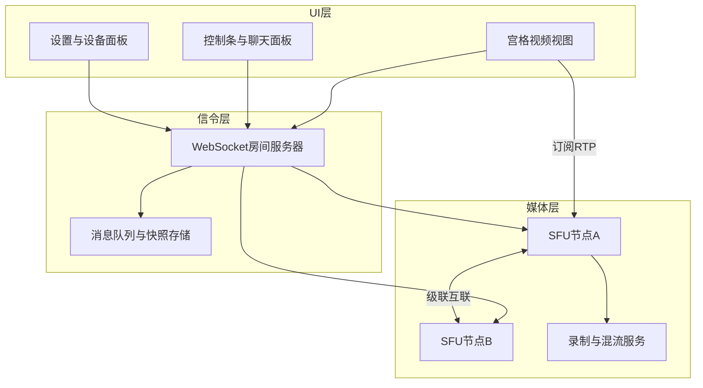

## AV-068：请设计一个网页版多人视频会议系统（完整架构）。（高频压轴）
**答**：
- 三层架构：UI 层（宫格/聚焦视图、控制条、聊天面板）、信令层（WebSocket 房间服务器，承载成员/SDP/消息）、媒体层（SFU，承载 RTP 转发与 simulcast 选层）。
- 数据流：join → 快照渲染 → publish（simulcast 三档）→ 按需 consume 他人 → 活跃说话人驱动宫格布局。
- 关键子系统：设备管理（AV-042）、弱网降级（AV-039）、录制（AV-038）、字幕（AV-076）。
- 大房间策略：>16 人自动切换"订阅 Top-N 活跃说话人 + 其余仅音频"。
- 可用性：信令重连补投（AV-061）、ICE restart（AV-062）、全量状态恢复。



```javascript
// 会议核心编排器（串联信令/SFU/UI 三层）
class Meeting {
  constructor(roomId) {
    this.sig = new ReliableSignaling(SIGNAL_URL, roomId);
    this.room = new RoomManager(this.sig);
    this.media = new SfuClient(this.sig);      // 封装 publish/consume
    this.adaptor = null;                        // 弱网适配
  }
  async start() {
    const local = await openWithFriendlyError(); // AV-043 错误兜底
    this.localStream = local;
    await this.media.publish(local, { simulcast: true });
    const snapshot = await this.room.join(ROOM_ID, { name: userName });
    this.renderGrid(snapshot);
    this.room.onJoin = (p) => this.media.consume(p.uid);      // 新成员
    this.room.onLeave = (uid) => this.removeGridItem(uid);    // 移除画面
    this.adaptor = new NetworkAdaptor(this.media.pc, this.media.senders);
    setInterval(() => this.adaptor.check(), 3000);
  }
  renderGrid({ peers }) {
    peers.forEach((p) => {
      const cell = createGridCell(p);
      if (p.hasVideo) this.media.consume(p.uid).then((s) => (cell.video.srcObject = s));
      grid.appendChild(cell);
    });
  }
  removeGridItem(uid) { grid.querySelector(`#cell-${uid}`)?.remove(); this.media.closeConsumer(uid); }
  async leave() { this.room.leave(); this.media.closeAll(); this.localStream?.getTracks().forEach((t) => t.stop()); }
}
```
