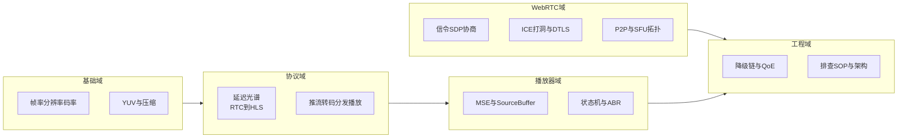

## AV-097：音视频前端知识体系收束：五域全景图。
**答**：
- 基础域：像素与帧（帧率/分辨率/码率/YUV）、压缩（I/P/B、GOP、心理声学）、封装与编码的分离思想。
- 协议域：一条延迟光谱（WebRTC → FLV → LL-HLS → HLS）与"推流-转码-分发-播放"的四段式架构。
- WebRTC 域：一条建连主线（信令 → SDP 协商 → ICE 打洞 → DTLS → RTP 流动）+ 三种拓扑（P2P/SFU/MCU）。
- 播放器域：MSE 为核心的黑盒边界（JS 管 demux 与调度，浏览器管 decode）+ 状态机/ABR/监控三大工程件。
- 工程域：把前四域装进真实业务——降级链、QoE 指标、排查 SOP、场景架构（会议/直播/教育）。
- 面试策略：以"延迟"为纲串全场（为什么 HLS 慢？为什么 RTC 快？代价是什么？），用排查案例证明工程深度。



```javascript
// 收束自检清单：能否不查资料回答以下问题
const SELF_CHECK = [
  '为什么直播分片切点必须在 I 帧？GOP 对秒开的影响？',
  'YUV 4:2:0 比 RGB 888 省多少？渲染解码帧时为什么常用三分纹理？',
  'HLS 延迟构成的每一项是什么？LL-HLS 靠哪三个机制降延迟？',
  'flv.js 的核心原理一句话？为什么要转 fMP4？',
  'Offer/Answer 交换的完整时序？glare 怎么解决？',
  'ICE 候选三种类型分别什么时候被选中？怎么确认当前走了 relay？',
  'MSE 的 appendBuffer 为什么会抛错？buffer 管理窗口怎么设？',
  '卡顿率的两种口径与归因字段？秒开怎么精确测量？',
  'simulcast 解决什么矛盾？SFU 为什么不解码？',
  '回声产生的原理？连麦场景哪个约束必须开？',
];
console.log(SELF_CHECK.forEach((q, i) => console.log(`${i + 1}. ${q}`)));
```
