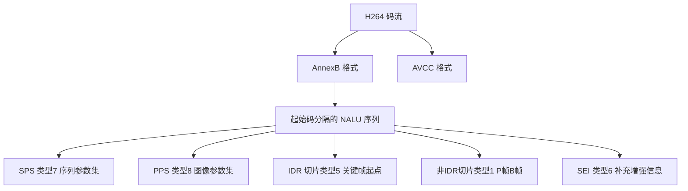

## AV-101：H264 码流结构是怎样的？NALU、SPS、PPS 各起什么作用？（高频压轴）
**答**：
- H264 分两层：VCL（视频压缩数据，slice）与 NAL（网络抽象层，负责打包传输），一个 NALU = 1 字节头 + RBSP 载荷。
- 码流两种格式：AnnexB（起始码 00 00 00 01 分隔，TS/裸流用）与 AVCC（长度前缀，MP4/FLV 用），MSE 喂 fMP4 用 AVCC，两者不能混喂。
- SPS（序列参数集）放 profile/分辨率/帧率等"这条流长什么样"；PPS（图像参数集）放熵编码方式等解码开关；解码器必须先拿到两者才能解 IDR 帧。
- 前端意义：换清晰度/seek 到新流时必须等新 SPS/PPS；播放器花屏十有八九是丢了参数集或丢了 I 帧（关联 AV-083）。
- NALU 类型看头部低 5 位：1=非 IDR 切片，5=IDR（关键帧起点），6=SEI，7=SPS，8=PPS。



```javascript
// AnnexB 码流分割：按起始码切出 NALU 并解析类型
function parseAnnexB(buffer) {
  const u8 = new Uint8Array(buffer);
  const nalus = [];
  const findStartCode = (i) => {
    while (i < u8.length - 3) {
      if (u8[i] === 0 && u8[i+1] === 0 && u8[i+2] === 1) return [i, 3];
      if (u8[i] === 0 && u8[i+1] === 0 && u8[i+2] === 0 && u8[i+3] === 1) return [i, 4];
      i++;
    }
    return [-1, 0];
  };
  let [pos, len] = findStartCode(0), start = -1;
  while (pos !== -1) {
    if (start >= 0) nalus.push(u8.subarray(start, pos)); // 上一 NALU 到此结束
    start = pos + len;
    [pos, len] = findStartCode(start);
  }
  if (start >= 0) nalus.push(u8.subarray(start));
  return nalus.map((n) => ({
    type: n[0] & 0x1f,                       // 7=SPS 8=PPS 5=IDR 1=非IDR
    isKeyframe: (n[0] & 0x1f) === 5,
    size: n.length,
  }));
}
```
