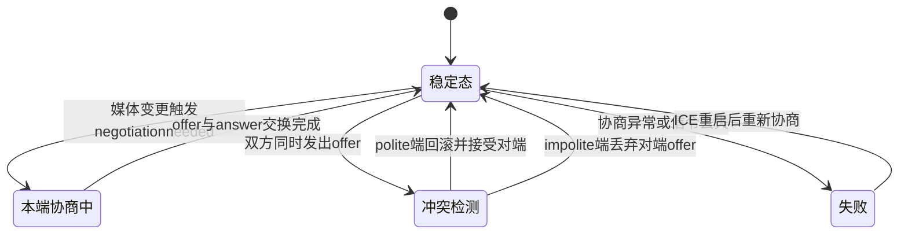

## AV-108：完美协商 perfect negotiation 是什么？polite/impolite 算法怎么写？（高频压轴）
**答**：
- 解决问题：双方同时发起 offer（glare 冲突），SDP 状态机不允许并发 setLocal/setRemote，需要确定性仲裁。
- 角色固定：impolite 一律坚持自己的 offer，polite 遇冲突回滚让步；角色由业务信令指定，不做动态选举。
- 核心三变量：makingOffer（本端协商中）、ignoreOffer（impolite 冲突时丢弃对端 offer）、isSettingRemoteAnswerPending。
- 现代浏览器 setLocalDescription() 无参自动生成 offer，polite 端冲突时 setRemoteDescription(offer) 会自动 rollback。
- 面试要点：能写出 onnegotiationneeded 竞态防护，并说清"冲突时 polite 回滚接受、impolite 静默丢弃"。



```javascript
// 完美协商标准实现（W3C 推荐写法）
class PerfectNegotiator {
  constructor(pc, socket, polite) {
    this.pc = pc; this.socket = socket; this.polite = polite;
    this.makingOffer = false;
    this.ignoreOffer = false;
    this.isSettingRemoteAnswerPending = false;
    pc.onnegotiationneeded = () => this.negotiate();
  }
  async negotiate() {
    try {
      this.makingOffer = true;
      await this.pc.setLocalDescription();      // 无参自动生成并应用 offer
      this.socket.emit('signal', { description: this.pc.localDescription });
    } finally { this.makingOffer = false; }
  }
  async onSignal({ description, candidate }) {
    if (description) {
      const readyForOffer = !this.makingOffer &&
        (this.pc.signalingState === 'stable' || this.isSettingRemoteAnswerPending);
      const offerCollision = description.type === 'offer' && !readyForOffer;
      this.ignoreOffer = !this.polite && offerCollision;   // impolite 丢弃对端 offer
      if (this.ignoreOffer) return;
      this.isSettingRemoteAnswerPending = description.type === 'answer';
      await this.pc.setRemoteDescription(description);     // polite 冲突时自动 rollback
      this.isSettingRemoteAnswerPending = false;
    } else if (candidate) {
      try { await this.pc.addIceCandidate(candidate); }
      catch (e) { if (!this.ignoreOffer) throw e; }        // 冲突期候选失败可容忍
    }
  }
}
```
