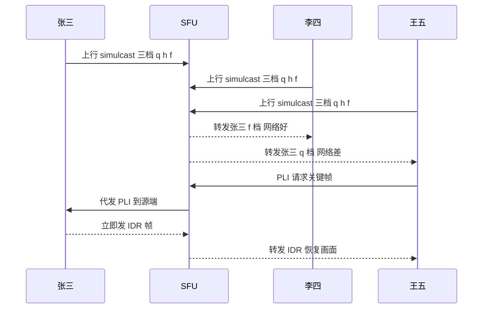

## AV-114：SFU 的核心原理是什么？为什么"只转发不编解码"能支撑大规模多人？（高频压轴）
**答**：
- SFU（Selective Forwarding Unit）：只做 RTP 包的选择性转发，不解码、不混流、不重编码，CPU 开销近似"转发带宽 × 订阅数"。
- 对比：Mesh 每人上行 N-1 路（上行是移动端最稀缺资源），MCU 服务端转码成本高；SFU 每人上行 1 路、下行 N-1 路。
- 转发的前提：simulcast/SVC 提供多档码流，让 SFU"有得选"；没有多档就只能全网统一最低码率。
- SFU 还承担：RTCP 终结与再生成（PLI/NACK/TWCC 汇聚）、房间路由、录制转推旁路输出。
- 成本特征：MCU 成本随规模平方增长，SFU 线性增长——这是会议类产品选 SFU 的根本原因。



```typescript
// mediasoup 风格核心对象关系（伪代码骨架）：Router → Transport → Producer/Consumer
const room = {
  router: await worker.createRouter({ mediaCodecs: [
    { kind: 'video', mimeType: 'video/VP8', clockRate: 90000 },
    { kind: 'audio', mimeType: 'audio/opus', clockRate: 48000 },
  ]}),
  peers: new Map<string, Peer>(),
};
async function publish(peerId: string, kind: 'video' | 'audio', rtpParameters: any) {
  const transport = await room.router.createWebRtcTransport({
    listenIps: [{ ip: '0.0.0.0', announcedIp: PUBLIC_IP }],
    enableUdp: true, enableTcp: true,
  });
  const producer = await transport.produce({ kind, rtpParameters });
  // 新 Producer 上线 → 房间内其他人各自 createConsumer 订阅它
  room.peers.forEach((p) => p.id !== peerId && p.consume(producer));
  return producer;
}
```
