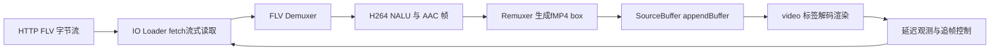

## AV-120：flv.js 的内部结构是怎样的？Remuxer 与 IO Loader 各干什么？（高频压轴）
**答**：
- 三层管线：IO Loader（fetch/WebSocket loader 拉字节流）→ Demux 层（FLV demuxer 拆出 H264 NALU 与 AAC 帧）→ Remuxer（转 fMP4 喂 MSE）。
- 为什么需要 Remux：浏览器 MSE 不吃 FLV 容器，只认 fMP4，所以要把 ES 流重新封装（mp4-generator 生成 box）。
- TransmuxingController 调度整条管线，可开 worker（enableWorker）避免阻塞主线程。
- 直播延迟关键在 IO 层与追帧：enableStashBuffer 要关（减少一跳缓冲），buffer 超阈值用追帧策略拉回。
- 源码阅读入口：transmuxer.js（管线调度）、flv-demuxer.js（tag 解析）、mp4-generator.js（box 生成）、fetch-stream-loader.js。



```typescript
import flvjs from 'flv.js';
if (!flvjs.isSupported()) fallbackToHls();          // MSE 探测失败走降级链
const player = flvjs.createPlayer({
  type: 'flv', isLive: true,
  url: 'https://cdn.example.com/live/stream1.flv',
  hasAudio: true, hasVideo: true,
}, {
  enableWorker: true,               // demux/remux 移入 worker
  enableStashBuffer: false,         // 直播必须关 IO stash 减少一跳缓冲
  stashInitialSize: 128,
  liveBufferLatencyChasing: true,   // buffer 超阈值自动加速追帧
  lazyLoad: false,                  // 直播不需要
});
player.attachMediaElement(videoEl);
player.load();
player.play();
player.on(flvjs.Events.ERROR, (_t: string, detail: string) => switchToHlsFallback(detail));
```
