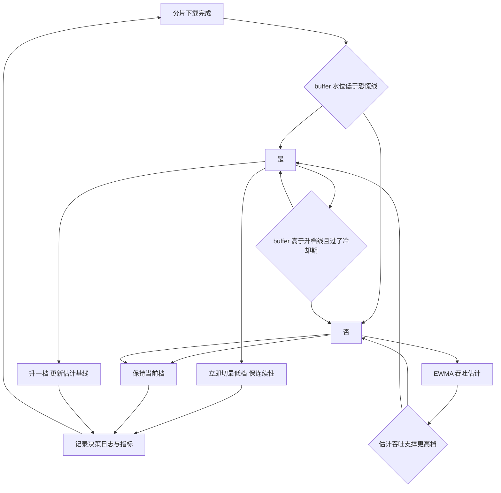

## AV-122：ABR 算法深入：吞吐估计型与 Buffer-based（BBA）各怎么工作？（高频）
**答**：
- 吞吐型（hls.js 默认）：EWMA 平滑历史吞吐 → 估计下一分片下载速度 → 选"吞吐吃得下"的最高档；对带宽波动敏感、易震荡。
- Buffer-based（BBA/Netflix）：只看当前 buffer 时长定档，buffer 低降档高升档，与吞吐解耦更稳，但起步阶段不友好。
- 工业方案是混合：buffer 告急立即降档（无视吞吐），正常时吞吐 + buffer 双因子，加滞回防抖动。
- 关键参数：panic 恐慌线（立即降档）、upgrade 升档水位、hysteresis 滞回与冷却时间。
- 前端落地：hls.js 自定义 abrController 或自研调度器，吞吐用分片下载实测，水位用 SourceBuffer.buffered。



```javascript
// 混合 ABR 调度器骨架：吞吐 EWMA + buffer 双因子
class HybridAbr {
  ewma = { alpha: 0.2, value: 1_500_000 };  // bps
  current = 0; lastSwitchAt = 0;
  constructor(ladder) { this.ladder = ladder; }   // [{ bitrate, height }]
  decide({ bufferSec, lastSegBytes, lastSegMs }) {
    if (lastSegMs > 0) {                            // EWMA 更新吞吐估计
      const throughput = (lastSegBytes * 8) / (lastSegMs / 1000);
      this.ewma.value = this.ewma.alpha * throughput + (1 - this.ewma.alpha) * this.ewma.value;
    }
    const PANIC = 4, UPGRADE = 12, COOLDOWN_MS = 2000;
    if (bufferSec < PANIC) return { level: 0, why: 'buffer panic' };            // 恐慌立即降档
    const fit = this.ladder.filter((l) => l.bitrate < this.ewma.value * 0.9);   // 预留10%安全边际
    let target = fit.length ? fit.length - 1 : 0;
    if (target > this.current && bufferSec < UPGRADE) target = this.current;    // 未达升档水位不升
    if (target > this.current && Date.now() - this.lastSwitchAt < COOLDOWN_MS) target = this.current;
    if (target !== this.current) { this.current = target; this.lastSwitchAt = Date.now(); }
    return { level: target, why: `thr=${Math.round(this.ewma.value / 1000)}kbps buf=${bufferSec.toFixed(1)}s` };
  }
}
```
