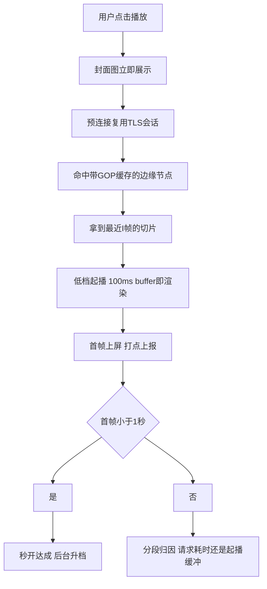

## AV-127：秒开率优化全链路怎么做？（高频压轴）
**答**：
- 先统一口径：首帧时间 = 用户点击 → 第一帧上屏；秒开率 = 首帧 < 1s 的播放占比（冷启动/热启动分开统计）。
- 服务端：GOP 缓存（新观众从最近 I 帧立即出画）、边缘预热（开播前把流拉到 CDN 边缘）、封面首帧图先渲染占位。
- 网络：预连接（DNS 预解析 + TCP/TLS 复用 + HTTP/2）、播放地址就近调度、防盗链签名预生成。
- 播放器：起播 buffer 阈值调小（直播 100-300ms 即播）、首帧锁低码率起播成功后升档、列表页预加载元数据。
- 闭环：全链路埋点（点击→请求→首包→首帧）分段归因，瓶颈在哪一段一目了然。



```javascript
// 首帧全链路埋点 + 秒开率数据产出
function instrumentPlayer(videoEl) {
  const t = { click: 0, request: 0, firstByte: 0, firstFrame: 0 };
  videoEl.addEventListener('loadeddata', () => {
    t.firstFrame = performance.now();
    const breakdown = {
      setup: Math.round(t.request - t.click),      // 预连接与签名耗时
      ttfb: Math.round(t.firstByte - t.request),   // CDN 响应 GOP缓存命中则很小
      buffer: Math.round(t.firstFrame - t.firstByte), // 起播缓冲 可压
      total: Math.round(t.firstFrame - t.click),
    };
    report({ metric: 'first-frame', ...breakdown, fastStart: breakdown.total < 1000 });
  });
  return {
    markClick: () => (t.click = performance.now()),
    markRequest: () => (t.request = performance.now()),
    markFirstByte: () => (t.firstByte = performance.now()),
  };
}
```
