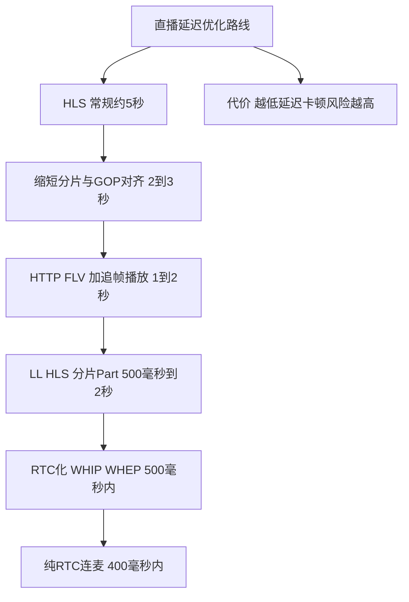

## AV-129：直播延迟优化：从 5 秒到 1 秒到 500ms 的完整路线？（高频压轴）
**答**：
- 先量化构成：总延迟 ≈ 编码缓冲 + 分片打包（约 GOP/2）+ CDN 传输 + 播放器起播缓冲；每段有名字才能治。
- 5s→2s：分片缩短到 1-2s、GOP 与分片对齐、减小 liveSyncDuration、少用/关闭 B 帧。
- 2s→1s：换 HTTP-FLV（无分片打包损耗）+ 播放器追帧（buffer 超阈值 1.1 倍速追赶）。
- 1s→500ms：LL-HLS（Part 分片传输）或 RTC 化（WHIP/WHEP 走 WebRTC 管线）；连麦场景直接纯 RTC <400ms。
- 代价曲线：延迟越低卡顿率越高（抖动吸收空间变小），按场景定目标——互动 500ms 内、电商 1-3s、赛事 3-5s 可接受。



```text
# 延迟分段归因表（生产排查模板 每段独立可测）
segment          | 典型值  | 测量方法
编码侧缓冲       | 0.5-2s  | 推流端时间戳 与 编码输出对比
分片打包         | 1-3s    | GOP长度 与 hls_time 分片时长
CDN传输          | 0.3-1s  | 边缘缓存刷新策略 与 回源链路
播放器起播缓冲   | 0.5-3s  | liveSyncDurationCount 乘 分片时长
追帧关闭时的累积 | 0-无上限 | 观测 30 分钟 buffer 漂移
场景目标建议
电商互动直播     | ≤2s     | FLV 加追帧
赛事转播         | 3-5s    | 标准 HLS 成本优先
连麦PK           | ≤600ms  | RTC 管线
```
