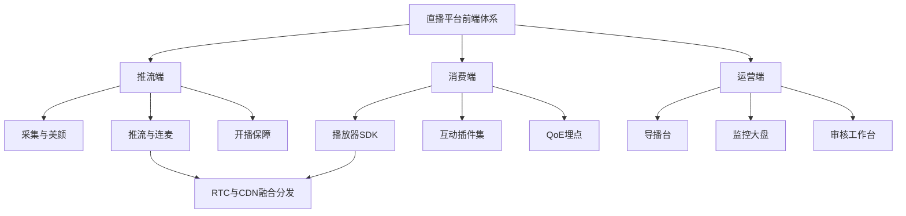

## AV-159：设计一个直播平台的前端体系全景。（高频压轴）
**答**：
- 三端角色：推流端（采集/编码/推流/连麦）、消费端（拉流播放/互动/消费）、运营端（导播/监控/审核工作台）。
- 全景链路：开播（推流→转码→分发）→ 观看（CDN→播放器→互动）→ 连麦（RTC 融合 AV-036）→ 回放（录制→点播）。
- 通用底座：播放器 SDK（AV-126）、监控埋点（AV-131/132）、房间信令（AV-061-064）、鉴权防盗链（AV-140）。
- 工程化：直播间模板化（布局 + 插件集），新业务品类 = 新模板；灰度与降级预案、A/B 实验（延迟档位 × UI 方案）。
- 度量体系：QoE 北极星（秒开/卡顿/时长）与业务指标（互动率/转化率）双轨对照。



```javascript
// 直播间页面 = 布局 + 插件集（模板化组装）
const livePage = createLiveRoom({
  layout: 'portrait-std',                                        // 竖屏标准位 竞猜类可切横屏位
  plugins: [
    playerPlugin({ protocols: ['flv', 'hls'], abr: 'hybrid' }),  // 播放器与ABR
    danmakuPlugin({ renderPool: 40, mergeWindow: 800 }),         // 弹幕聚合渲染
    giftPlugin({ animPool: 20 }),                                // 礼物特效池
    interactionPlugin({ quiz: true, redpacket: true }),          // 互动
    qoePlugin({ sample: 0.05 }),                                 // QoE 埋点
    degradePlugin({ chain: ['flv', 'hls', 'static-cover'] }),    // 降级链
  ],
});
// 新直播品类 = 新模板：竞猜直播 = landscape 布局 + quizPlugin 加强 + 延迟敏感档位
```
