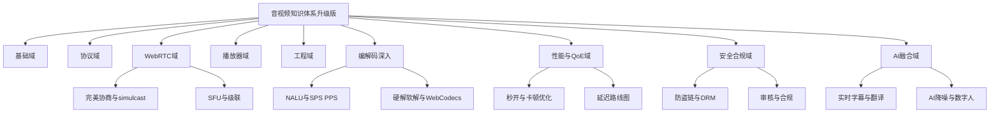

## AV-196：音视频知识体系总收束：五域全景升级版。（高频）
**答**：
- 在 AV-097 的五域（基础/协议/WebRTC/播放器/工程）之上升级为九域：新增编解码深入、性能与 QoE、安全合规、AI 融合。
- 主线不变：延迟光谱（决定协议选型）、建连主线（信令→SDP→ICE→DTLS→SRTP）、播放主线（fetch→demux→MSE→decode→render）。
- 进阶主线：媒体服务器域（SFU 是 RTC 的服务端大脑）、跨端域（移动/小程序差异）、AI 域（字幕/降噪/审核）。
- 面试策略：用"全景图 + 三条主线"开场定调，再按面试官追问下钻到具体题目。
- 终极检验：能否把"一场 10 万人观看加万人连麦的演唱会"从推流到渲染讲一遍全链路。



```javascript
// 九域自检：面试前逐项打分 低于 3 分的回对应章节补课
const SELF_CHECK = {
  '基础域': 'YUV/GOP/封装 能手算码率与延迟',
  '协议域': 'HLS/FLV/RTMP/WHIP 延迟光谱脱口而出',
  'WebRTC域': 'SDP/ICE/DTLS 完整建连时序',
  '播放器域': 'MSE/ABR/状态机/错误恢复',
  '工程域': '埋点/降级/排查SOP',
  '编解码深入': 'NALU/SPS-PPS/WebCodecs',
  '性能QoE': '秒开链路/卡顿归因/延迟路线',
  '安全合规': '防盗链/DRM/审核/隐私',
  'AI融合': '流式ASR/降噪/数字人',
};
Object.entries(SELF_CHECK).forEach(([k, v]) => console.log(`[${k}] ${v}`));
```
