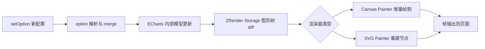

## VIZ-030：ECharts 的整体架构是怎样的？ZRender 扮演什么角色？
**答**：自上而下四层：**option 声明层** → **内部模型层**（M/C/V，把 option 解析成坐标系、series、组件模型并做 diff）→ **ZRender 渲染引擎**——它是 ECharts 与具体绘图 API 之间的抽象层，包含 Storage（场景图形树）、Painter（可插拔的 canvas/svg/vml 渲染后端）、Handler（命中检测与事件分发）、Animation（补间）。理解这条链路的意义：性能问题要定位是模型层算得慢还是 Painter 画得慢；`chart.getZr()` 能拿到 ZRender 实例做底层定制。



```javascript
// ECharts 分层：Option -> 内部模型 -> ZRender（Storage + Painter + Handler + Animation）
const chart = echarts.init(el, undefined, { renderer: 'canvas' });
// renderer 可选 canvas / svg：canvas 适合大数据量，svg 适合强交互小图与无失真导出
chart.setOption({
  xAxis: { type: 'category', data: ['A', 'B', 'C'] },
  yAxis: {},
  series: [{ type: 'bar', data: [1, 2, 3] }],
});
// ZRender 暴露底层能力：绕过 series 直接操作图形元素或监听空白区事件
chart.getZr().on('click', p => console.log('zrender 坐标', p.offsetX, p.offsetY));
```
