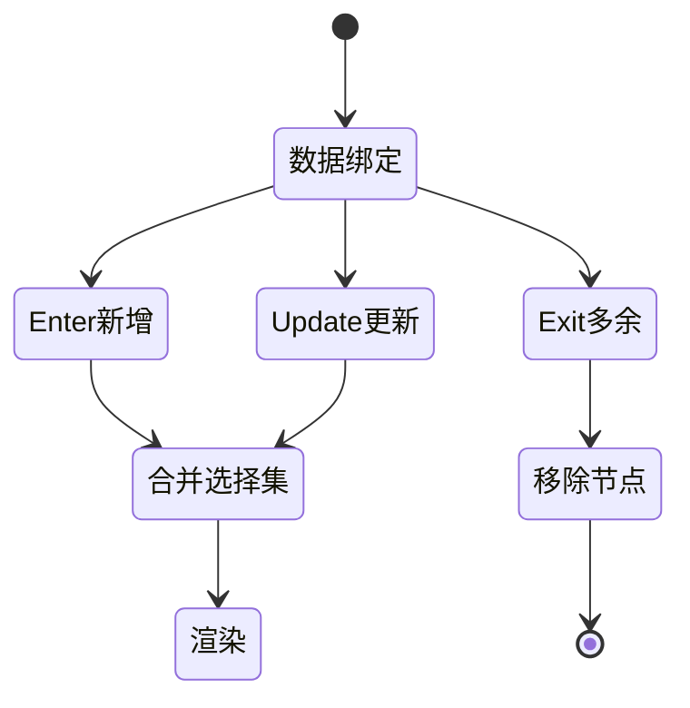

## VIZ-038：解释 D3 的 data join 思想（enter / update / exit）。（压轴）
**答**：D3 渲染不是"命令式地增删节点"，而是声明式地把**数据集与 DOM 选择集做对齐**：按 key 函数匹配后数据分成三部分——已有节点（update）、多出来的数据（enter）、多出来的节点（exit）。`selection.join(enter, update, exit)` 一次写全三个分支，且每支都能挂自己的过渡动画。key 函数是精髓：默认按索引对齐会在排序/过滤时错位，按业务 id 对齐才能做增量复用与平滑移动。这套思想正是后来 Virtual DOM diff 的同源思想。



```javascript
const circles = svg.selectAll('circle').data(data, d => d.id); // key 函数保证增量复用
circles.join(
  enter => enter.append('circle')
    .attr('r', 0)
    .attr('cy', 50)
    .call(e => e.transition().attr('r', 4)),          // 新元素入场动画
  update => update
    .call(u => u.transition()                          // 既有元素平滑移动到新位置
      .attr('cx', d => x(d.value))),
  exit => exit.transition().attr('r', 0).remove()      // 多余元素退场后移除
);
// data join 是声明式对齐：每次渲染都是"当前数据 -> 目标 DOM"，而非手动增删节点
```
