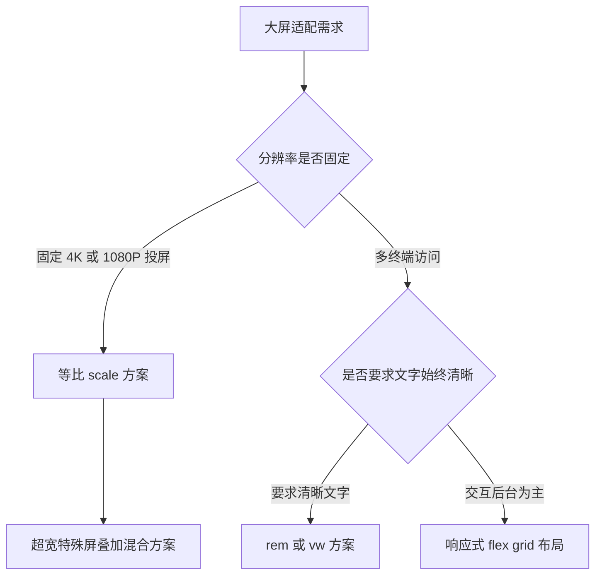

## VIZ-060：大屏适配方案有哪些？如何选型？（压轴）
**答**：三大方案：**等比 scale**——设计稿固定 1920×1080，整体 `transform: scale(min(sw/dw, sh/dh))` 居中，实现最简单、还原度 100%，缺点是文字放大发虚、事件坐标需换算；**rem/vw**——根字号或 CSS 单位随屏宽缩放，文字始终清晰，但所有尺寸都要换算、宽高比不一致时布局会变形；**响应式布局**——flex/grid 自适应，适合后台不固定分辨率。混合方案最常见：外层 scale 等比 + 内部关键文字用 rem 二次修正。决策看"是否固定分辨率 + 是否要求文字清晰 + 是否多终端"。



```javascript
// 等比缩放：设计稿 1920x1080，按宽高小的一边缩放并居中留黑
function fitScale(designW = 1920, designH = 1080) {
  const screen = { w: window.innerWidth, h: window.innerHeight };
  const scale = Math.min(screen.w / designW, screen.h / designH);
  const el = document.getElementById('screen');
  el.style.width = designW + 'px';
  el.style.height = designH + 'px';
  el.style.transform = `scale(${scale})`;
  el.style.transformOrigin = 'left top';
  el.style.position = 'absolute';
  el.style.left = (screen.w - designW * scale) / 2 + 'px'; // 水平居中
  el.style.top = (screen.h - designH * scale) / 2 + 'px';
}
window.addEventListener('resize', fitScale);
fitScale();
// scale 方案注意：图表 resize 需按设计稿尺寸即可；鼠标事件坐标在缩放容器内自动正确（同一坐标系）
```
