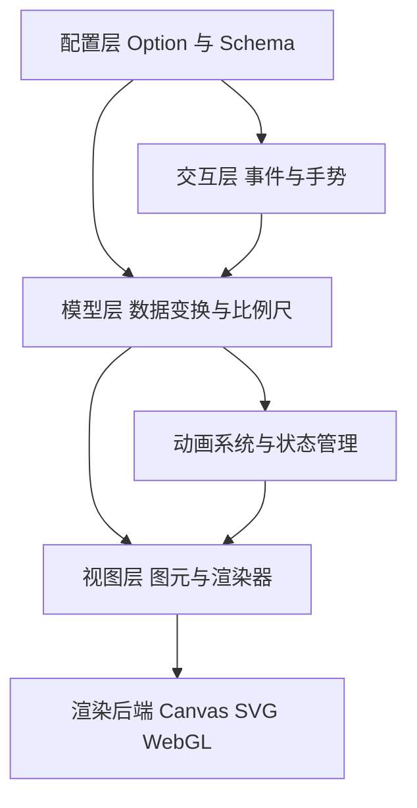

## VIZ-068：如何设计一个可视化图表库的核心架构？（压轴）
**答**：经典四层：**配置层**——声明式 option/schema，负责校验、merge、默认值；**模型层**——数据变换、比例尺、布局计算，产出与渲染无关的图元描述（纯函数，可单测）；**渲染层**——图元 → 像素/节点，可插拔 Canvas/SVG/WebGL 后端；**交互层**——事件 → 命中检测 → 语义事件（hover/click/brush），与渲染解耦。横向能力：动画系统、状态管理（可见系列/缩放域）、插件化系列类型。设计检验标准：换渲染后端不动模型、加一种图表类型不改核心、交互可撤销。



```javascript
// 图表库核心分层：配置层声明式 option，模型层算坐标，渲染层画像素，交互层给语义事件
class Chart {
  constructor(el, option) {
    this.el = el;
    this.option = option;
    this.renderer = new CanvasRenderer(el);   // 可插拔：SVGRenderer / WebGLRenderer
    this.listeners = new Map();
    this.bindEvents();
  }
  setOption(next) {                            // 配置层：merge + 校验
    this.option = mergeOption(this.option, next);
    this.render();
  }
  render() {                                   // 模型层：数据 -> 比例尺 -> 图元
    const marks = computeMarks(this.option);   // 纯函数：可单测、可缓存
    this.renderer.clear();
    for (const m of marks) this.renderer.draw(m); // 渲染层：图元 -> 像素
  }
  bindEvents() {                               // 交互层：像素事件 -> 语义事件
    this.el.addEventListener('mousemove', e =>
      this.emit('hover', hitTest(computeMarks(this.option), e.offsetX, e.offsetY)));
  }
  on(type, fn) { this.listeners.set(type, fn); }
  emit(type, payload) { this.listeners.get(type)?.(payload); }
}
```
