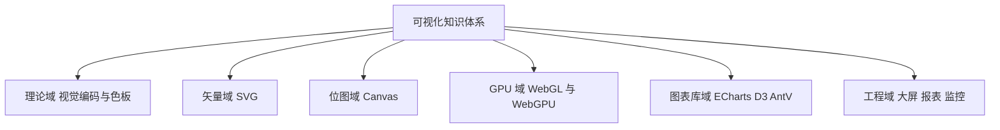

## VIZ-100：WebGPU 与可视化未来概览 + 知识体系收束。
**答**：WebGPU 相比 WebGL 对可视化的增益：Compute Shader 把聚合/布局搬到 GPU（百万点分桶不占主线程）、原生 instancing 与 indirect draw、更低的驱动开销与更好的多线程提交。现状：Chrome/Edge 已稳定，Safari/Firefox 跟进中，未来数年仍需 WebGL/Canvas 降级路径。收束全专题：理论定对错（视觉编码/色板）、SVG 定交互、Canvas 定规模、WebGL/WebGPU 定上限、图表库定效率、工程域定落地——六域合一看任何可视化需求都能迅速定位技术路径。



```javascript
// WebGPU 相比 WebGL 的可视化收益：Compute 聚合、原生 instancing、更低驱动开销
const adapter = await navigator.gpu?.requestAdapter();
if (adapter) {
  const device = await adapter.requestDevice();
  const ctx = canvas.getContext('webgpu');
  const format = navigator.gpu.getPreferredCanvasFormat();
  ctx.configure({ device, format, alphaMode: 'opaque' });
  // 百万级点：positions 写 GPUBuffer，compute pass 分桶聚合，render pass 直接绘制
} else {
  initWebGLFallback(); // 未来若干年仍需 WebGL/Canvas 降级路径
}
// 收束：理论定对错、SVG 定交互、Canvas 定规模、WebGL/WebGPU 定上限、
// 图表库定效率、工程域定落地——六域合一定位任何可视化需求
```

---

## 十一、WebGL 进阶（VIZ-101 ~ VIZ-107）
