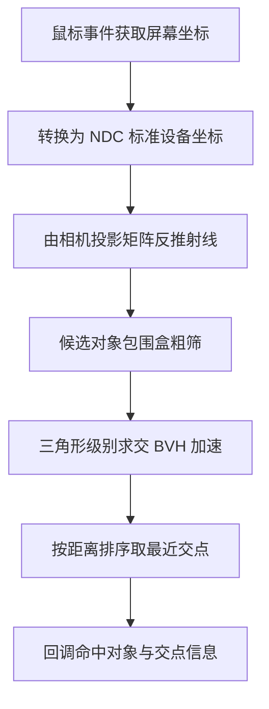

## VIZ-104：WebGL / Three.js 的射线拾取原理是什么？如何高效拾取？
**答**：原理：屏幕坐标 → NDC → 逆投影得到**射线 origin + direction** → 与场景物体求交（三角形级别用 Möller–Trumbore，粗筛用包围球/AABB），取距离最近者。Three.js 的 `Raycaster.intersectObjects` 默认遍历所有三角形，对象一多就卡；优化三板斧：① three-mesh-bvh 加速求交；② 只对可交互层拾取（layers/分组隔离）；③ GPU 拾取——把对象 id 编码成颜色渲染到 1x1 FBO 用 readPixels 读回。拾取频率务必节流到每帧一次。



```javascript
// 屏幕坐标 -> NDC -> 射线 -> 求交，Three.js 用法与节流要点
function ndcFromEvent(e, canvas) {
  const r = canvas.getBoundingClientRect();
  return new THREE.Vector2(
    ((e.clientX - r.left) / r.width) * 2 - 1,
    -((e.clientY - r.top) / r.height) * 2 + 1  // y 轴翻转
  );
}
const raycaster = new THREE.Raycaster();
raycaster.layers.set(1);                 // 只拾取第 1 层的可交互对象
let pendingNdc = null;
canvas.addEventListener('pointermove', e => {
  pendingNdc = ndcFromEvent(e, canvas);  // 事件里只记录，rAF 中统一处理
});
function pickInFrame() {
  if (pendingNdc) {
    raycaster.setFromCamera(pendingNdc, camera);
    const hits = raycaster.intersectObjects(interactives, false);
    if (hits.length) onHover(hits[0]);   // hits 按距离排序，取最近
    pendingNdc = null;
  }
  requestAnimationFrame(pickInFrame);
}
```
