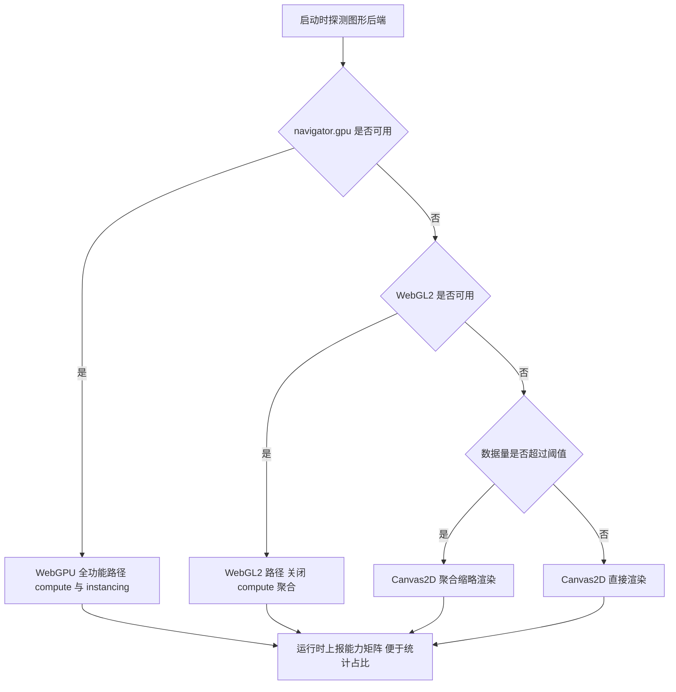

## VIZ-111：WebGPU 的兼容性现状如何？降级策略怎么设计？
**答**：截至 2026 年初：Chrome/Edge 113+ 稳定（含 Android），Safari 已跟进稳定，Firefox 逐步铺开；企业内网旧浏览器与部分低端安卓仍是空白。降级策略分层：① 能力检测 `navigator.gpu?.requestAdapter()` 失败 → WebGL2 → WebGL1 → Canvas 2D（大规模点用聚合缩略）；② 按"效果分级"降级：WebGPU 独有的 compute 聚合退化为 Worker/主线程聚合；③ 统一渲染抽象层（或用 Three.js WebGPURenderer 自动 fallback），业务代码不感知后端。关键是把"后端能力"做成运行时探测的特性矩阵并上报监控。



```javascript
// 能力探测与后端选择：特性矩阵驱动，业务不感知后端
async function pickBackend(canvas) {
  if (navigator.gpu) {
    try {
      const adapter = await navigator.gpu.requestAdapter();
      if (adapter) {
        const device = await adapter.requestDevice();
        return initWebGPU(canvas, device);   // 全功能：compute + 原生 instancing
      }
    } catch (e) { /* 探测失败，继续降级 */ }
  }
  const gl2 = canvas.getContext('webgl2');
  if (gl2) return initWebGL2(canvas, gl2);   // 降级：CPU 聚合 + instancing 扩展
  return initCanvas2D(canvas);               // 兜底：聚合缩略 + 静态图层
}
// 能力矩阵示例：{ compute: true, maxTextureSize: 8192, backend: 'webgpu' }
```

---

## 十三、数据可视化高级图表（VIZ-112 ~ VIZ-118）
