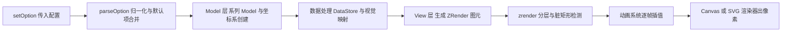

## VIZ-119：从 option 到像素，ECharts 的渲染流程是怎样的？（源码级，压轴）
**答**：`setOption(option)` 后链路：① **parseOption**——归一化配置、合并默认项，OptionManager 管理原始配置；② **Model 层**——每个组件/系列由对应 Model 类持有内部模型，坐标系（CoordinateSystem）在此创建；③ **数据处理**——数据进入 DataStore/List，做 stack/filter 与**视觉映射**（颜色、symbol 大小由 visual encoder 生成）；④ **View 层**——每个 Series/Component 的 View 用模型生成 **ZRender 图元**（Displayable）；⑤ **zrender**——分层、脏矩形、动画插值与增量刷新，最终由 Canvas/SVG 渲染器出像素。理解这条链才能解释 lazyUpdate 为何快、动画为何在 zrender 层。



```javascript
// 面向源码的调试手段：观察 option -> model -> view 链路
const chart = echarts.init(dom);
chart.setOption({ series: [{ type: 'line', data: [1, 2, 3] }] });
console.log(chart.getModel().getSeriesByIndex(0));            // Model 层内部模型
console.log(chart.getModel().getSeriesByIndex(0).getData());  // 处理后的数据 List
const zr = chart.getZr();                                     // zrender 实例
console.log(zr.painter.getLayers().map(l => l.dom.id));       // 分层：zr_0 / zr_1 ...
zr.storage.getDisplayList().slice(0, 5).forEach(el =>
  console.log(el.type, el.animators?.length));                // 图元与其动画器
// 性能 API 与链路的对应：lazyUpdate -> 合并多次 setOption；
// progressive -> View 层分片生成图元；hoverLayerThreshold -> 命中层隔离
```
