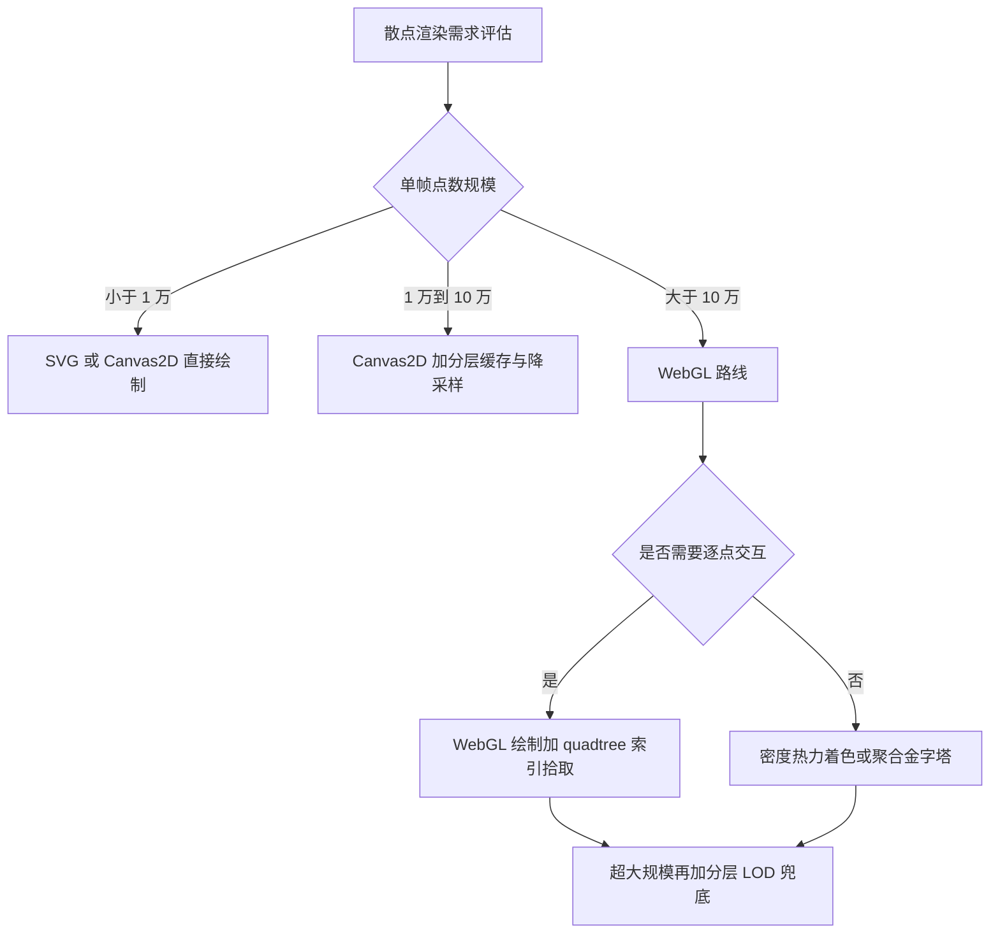

## VIZ-126：百万级散点图如何渲染？（WebGL instancing，压轴）
**答**：Canvas 2D 上限约 1~5 万点/帧，百万点必须 WebGL。方案阶梯：① **逐点 drawArrays(POINTS)**——一个 STATIC_DRAW buffer 装全部顶点，顶点着色器算屏幕坐标，一次 draw call；② **instancing**——点带贴图（圆/方形 sprite）时 instanced quad 更灵活；③ 工业实现直接用 deck.gl ScatterplotLayer。关键配套：命中检测用 **quadtree/网格索引**（CPU 做，与渲染解耦），缩放配降采样金字塔，或用密度着色（每像素计数）替代逐点绘制。



```javascript
// WebGL 百万点：单 draw call 渲染 + CPU 索引拾取，两者解耦
const gl = canvas.getContext('webgl');
const positions = new Float32Array(N * 2);
// ...填充数据
gl.bindBuffer(gl.ARRAY_BUFFER, posBuf);
gl.bufferData(gl.ARRAY_BUFFER, positions, gl.STATIC_DRAW); // 一次性上传
gl.vertexAttribPointer(aPosLoc, 2, gl.FLOAT, false, 0, 0);
gl.enableVertexAttribArray(aPosLoc);
gl.drawArrays(gl.POINTS, 0, N);   // 顶点着色器内做 MVP 与 gl_PointSize
// 拾取走 CPU 索引，与 GPU 渲染解耦
import Quadtree from 'quadtree-lib';
const qt = new Quadtree({ width: W, height: H, maxElements: 16 });
points.forEach((p, i) => qt.add({ x: p[0], y: p[1], i }));
function pickAt(mx, my, radius = 5) {
  return qt.collides({ x: mx - radius, y: my - radius,
                       width: radius * 2, height: radius * 2 }); // 命中候选
}
```
