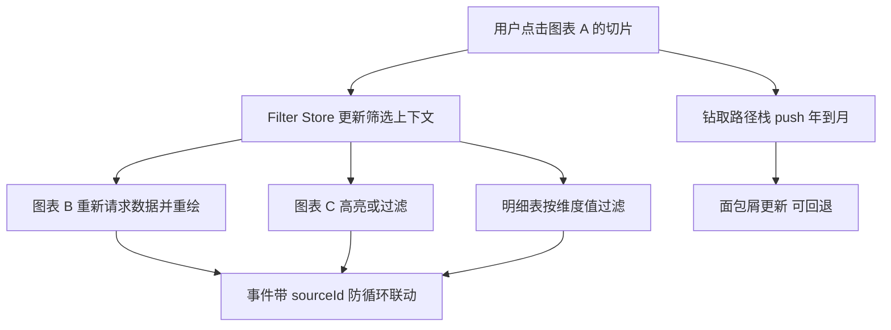

## VIZ-139：图表↔图表↔明细的下钻钻取联动体系如何设计？
**答**：核心是**以"筛选/钻取上下文"为中心的事件总线**：① 全局 filterStore 持有当前筛选（维度值集、时间窗、钻取路径）；② 图表发出 select/drill action → store 更新 → 订阅者各自 refetch/re-encode，事件带 sourceId 防循环（自己不响应自己）；③ 钻取是"维度路径栈"（年→季→月→日），push/pop 即上下层切换，面包屑展示可回退；④ 图表→明细表联动 = 把选中维度值作为明细查询条件；⑤ 筛选状态同步到 URL 支持分享。



```javascript
// 联动总线：filterStore + 来源标记 + 钻取栈
const filterStore = {
  filters: new Map(), drillStack: [], listeners: new Set(),
  setFilter(dim, values, sourceId) {
    this.filters.set(dim, values);
    this.emit({ type: 'filter', sourceId });
  },
  drill(dim, value) {                        // 下钻：维度路径入栈
    this.drillStack.push({ dim, value });
    this.emit({ type: 'drill', sourceId: 'chart-A' });
  },
  breadcrumb() { return this.drillStack.map(d => `${d.dim}=${d.value}`).join(' > '); },
  emit(evt) { this.listeners.forEach(fn => fn(evt)); },
};
filterStore.listeners.add(evt => {
  document.querySelectorAll('[data-chart]').forEach(el => {
    if (el.dataset.chart === evt.sourceId) return;   // 自己不响应自己，防循环
    refetchWithFilters(el, filterStore.filters);
  });
});
chartA.on('click', p => filterStore.drill('region', p.name));
```
