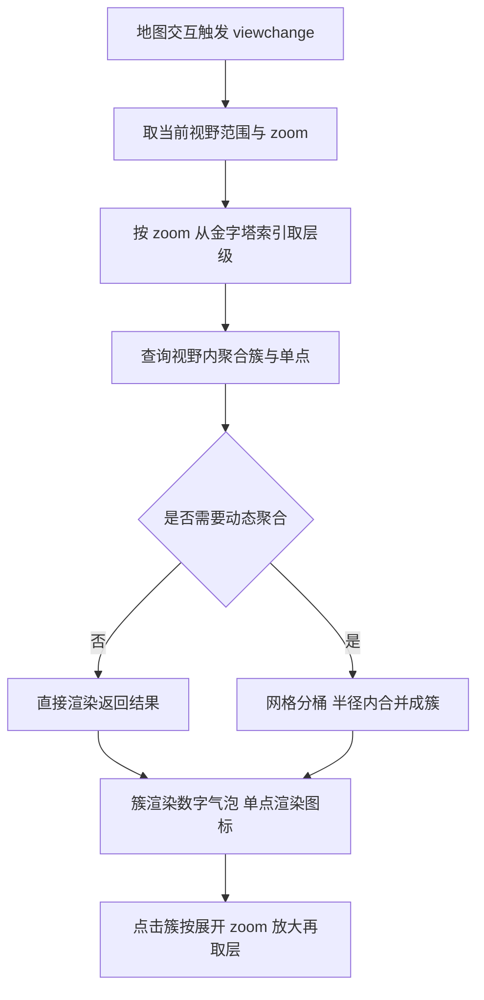

## VIZ-146：海量点位如何渲染与聚合？（点聚合算法，压轴）
**答**：分层方案：① **缩放分级**——zoom 低于阈值用聚合，放大后展示原始点；② **聚合算法**——网格聚合（O(n)，按 tile+网格 key 分桶）、DBSCAN、或 **Supercluster 金字塔索引**（预建多级聚合，查询时按 zoom 取层，事实标准）；③ **渲染**——万级以下 Canvas，海量化用 deck.gl/icon 层；④ **热力替代**——只关心密度不关心单点时用热力图（h3 六边形/方格聚合）。核心认知：聚合查询要 O(视野内点数) 而不是 O(全量)，所以必须预建索引。



```javascript
// Supercluster 点聚合：预建金字塔索引，缩放即查表
import Supercluster from 'supercluster';
const index = new Supercluster({ maxZoom: 16, radius: 60 }); // 60px 半径内的点聚成一簇
index.load(points.map(p => ({
  type: 'Feature', geometry: { type: 'Point', coordinates: p.coord }, properties: p,
})));
map.on('move', () => {
  const bbox = map.getBounds().toArray().flat();   // 当前视野
  const clusters = index.getClusters(bbox, Math.round(map.getZoom())); // 毫秒级
  renderMarkers(clusters);  // 簇有 properties.cluster 与 point_count，画数字气泡
});
map.on('click', e => {
  const f = map.queryRenderedFeatures(e.point)[0];
  if (f?.properties?.cluster) {
    map.easeTo({ zoom: index.getClusterExpansionZoom(f.properties.cluster_id),
                 center: f.geometry.coordinates });  // 展开簇的最优 zoom
  }
});
```
