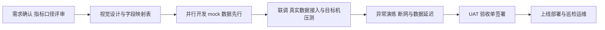

## VIZ-192：大屏项目的交付流程（需求 → 设计 → 联调 → 验收）。
**答**：五阶段：① **需求**——业务指标清单确认（**口径评审**）、数据可得性确认、目标硬件确认（分辨率/盒子型号）；② **设计**——视觉稿（1920 基准）+ 动效稿 + 数据字段映射表；③ **开发**——前端/数据/后端并行，mock 数据先行，视觉走查；④ **联调**——真实数据接入 + 目标机硬件实测压测 + 异常演练（断网/数据延迟/接口 5xx）；⑤ **验收与运维**——UAT 验收单、上线部署、SLA 监控与自动巡检（VIZ-172）。最大坑：需求阶段不确认指标口径，联调期返工；第二坑：没在目标硬件上实测，上线后才发现掉帧。



```javascript
// 交付 checklist：各阶段准出条件
const deliveryChecklist = {
  需求: ['指标清单与口径评审通过', '数据源可得性确认', '目标硬件清单确认'],
  设计: ['1920 基准视觉稿', '动效稿与时长标注', '数据字段映射表'],
  开发: ['mock 数据先行联调', '组件级性能预算声明', '视觉走查通过'],
  联调: ['目标机实测帧率达标', '断网 5 分钟自动恢复验证', '数据延迟降级表现验证'],
  验收: ['UAT 验收单签署', '巡检机器人接入', '值班与回滚预案'],
};
function gate(stage) {                           // 阶段准出：未全过不进入下一阶段
  const unmet = deliveryChecklist[stage].filter(item => !done(item));
  if (unmet.length) throw new Error(`${stage} 阶段未准出: ${unmet.join('、')}`);
}
```
