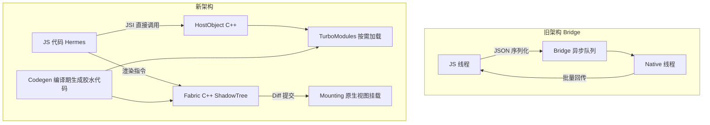

## XP-007：RN 架构从 Bridge 到新架构（JSI/TurboModules/Fabric）是如何演进的？
**答**：
- **旧架构 Bridge**：JS 与 Native 异步批量消息通信，JSON 序列化、无法同步调用、丢函数引用，是性能与能力的天花板。
- **JSI**：用 C++ 层替代 Bridge，JS 直接持有原生对象的引用（HostObject），支持同步调用与任意 JS 引擎。
- **新架构三件套**：TurboModules（按需加载的原生模块）+ Fabric（新渲染器，C++ ShadowTree、同步可中断布局）+ Codegen（编译期生成胶水代码，去掉运行时反射）。
- Hermes 引擎配合：字节码免编译、启动更快、内存更省，且与 JSI 深度绑定。
- 演进动机一句话：**把"异步消息总线"升级为"同步直接调用 + 编译期契约"**。



```typescript
// 旧架构：Bridge 异步 + JSON 序列化，无法拿到同步返回值
NativeModulesOld.DeviceInfo.getDeviceId().then((id: string) => { /* 异步回调 */ });

// 新架构：通过 JSI 暴露的 TurboModule，JS 直接持有原生对象引用
import { requireNativeModule } from 'expo-modules-core'; // 或 turbo-module 注册产物
const DeviceInfo = requireNativeModule<{ getDeviceId: () => string }>('DeviceInfo');

const id: string = DeviceInfo.getDeviceId(); // 同步调用，无 JSON 序列化
// 底层：JS 侧拿到的是 JSI HostObject 代理，
// 方法调用直接进入 C++，绑定到原生实现，参数经 JSI Value 直接转换
```
