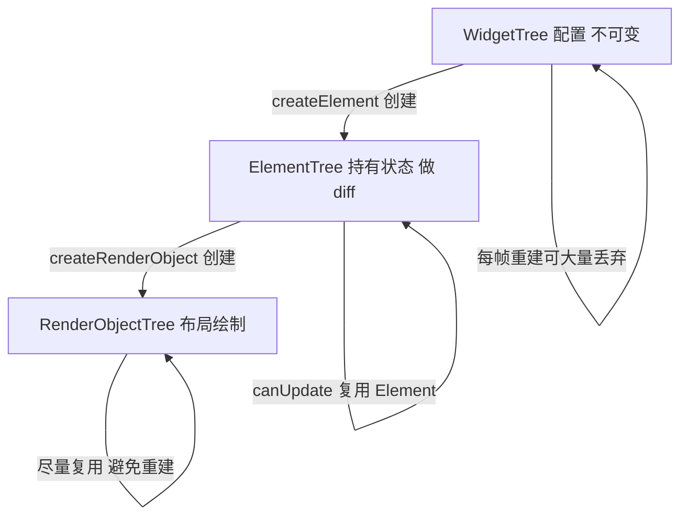

## XP-017：Flutter 三棵树（Widget/Element/RenderObject）的关系？
**答**：
- **Widget**：不可变的配置描述（轻量，每帧可大量重建），持有树的形状与参数。
- **Element**：Widget 的实例化载体与**上下文**，持有生命周期、状态（State）与父子关系，是 diff 的锚点——`canUpdate`（runtimeType + key 相同）决定复用还是重建。
- **RenderObject**：真正参与布局、绘制、命中测试的对象，重而持久，尽量复用。
- 三棵树意义：**Widget 便宜所以随便重建，Element 守住状态做 diff，RenderObject 昂贵所以少动**，这是 Flutter 高刷新性能的结构基础。
- 面试追问：StatefulElement 持有 State，Widget 重建不丢状态就是 Element 在复用。



```dart
// 三棵树的观察与关系
final key = GlobalKey();
Stack(children: [
  Positioned(key: key, left: 0, top: 0, child: Container(width: 100, height: 40)),
]);

void inspectTrees(BuildContext context) {
  final element = key.currentContext!;              // Element 树节点
  final widget = element.widget;                    // 上一行对应的 Widget 配置
  final renderObj = element.findRenderObject()!;    // RenderObject 树节点
  debugPrint('${widget.runtimeType} / ${renderObj.runtimeType}');
  // StatelessWidget 没有对应 RenderObject，Element 只是组合作业：
  // 如 StatelessWidget 直接 build 子树，布局由子级 RenderObject 承担
}
// 迁移示例：把 Positioned 换成 Align（不同 runtimeType）→ canUpdate 失败 →
// Element 与 RenderObject 一起销毁重建；只换属性（如 left: 20）→ 仅 markNeedsLayout
```
