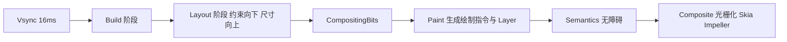

## XP-019：Flutter 渲染流水线（build→layout→paint→composite）是怎样跑起来的？
**答**：
- Vsync 驱动：每帧经 **Animator→Build→Layout→CompositingBits→Paint→Semantics→Finalize** 七个阶段（SchedulerBinding 的 persistent frame callbacks）。
- Build：执行 setState 标脏的 Element 的 rebuild，产出新 Widget；Layout：RenderObject 树从上向下传约束、从下向上传尺寸（一次 O(n) 遍历）；Paint：生成 LayerTree/绘制指令。
- Composite：Layer 树交给 Skia/Impeller 光栅化到 GPU。 RepaintBoundary 会隔离重绘，子树变化只重建其下 Layer。
- 关键约束：布局是**单遍**的（constraints down / size up），保证 60fps 下一帧内完成；任何同步回读尺寸（如 `context.size` 在 build 里）都会强制再跑一帧。
- 排查工具：DevTools Performance 里看每阶段耗时，红条即超 16ms。



```dart
// 观察流水线 + RepaintBoundary 隔离重绘
void watchPipeline() {
  WidgetsBinding.instance.addTimingsCallback((timings) {
    for (final t in timings) {
      debugPrint('build=${t.buildDuration} raster=${t.rasterDuration} vsyncOverhead=${t.vsyncOverhead}');
      if (t.buildDuration > const Duration(milliseconds: 8)) {
        reportSlowFrame(t); // 上报慢帧：优先查 build 阶段
      }
    }
  });
}

class Timeline extends StatelessWidget {
  const Timeline({super.key});
  @override
  Widget build(BuildContext context) {
    return ListView.builder(
      itemBuilder: (_, i) => RepaintBoundary(           // 隔离：单条变化不整页重绘
        child: ListTile(title: Text('event $i')),
      ),
    );
  }
}
// setState → markNeedsBuild(标脏 Element) → 下一帧 Build；
// 布局改动 → markNeedsLayout；仅外观改动 → markNeedsPaint，跳过 layout 更省
```
