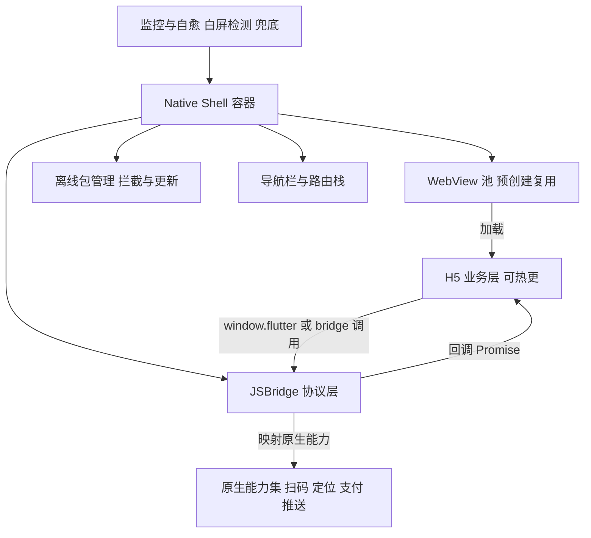

## XP-026：Hybrid App 的整体架构是怎样的（Native Shell + H5）？
**答**：
- 组成：**Native Shell**（容器：WebView 池、JSBridge、离线包、导航栏、原生能力集）+ **H5 业务层**（页面资源，可热更）。
- 生命周期：Shell 启动 → 预创建 WebView → 加载离线包/CDN 资源 → 注入 JSBridge 与登录态 → 页面运行 → 销毁回收。
- 关键子系统：桥协议（XP-028）、离线包（XP-030）、监控自愈（XP-031）、路由与导航协作（XP-032）。
- 定位：适合内容展示/运营页/低交互频次业务；强交互（长列表、复杂手势）应让位给原生或 RN/Flutter。
- 现代演进：小程序容器本质上是 Hybrid 的"受控加强版"（双线程+组件化+审核机制）。



```text
hybrid-app/
├── shell-android/            # Native Shell（Android）
│   ├── webview/              #   WebView 池与预创建、复用策略
│   ├── bridge/               #   JSBridge 注册表与协议分发（对应 XP-028）
│   ├── offline/              #   离线包下载/校验/shouldInterceptRequest（XP-030）
│   └── monitor/              #   白屏检测、JS 异常桥回传、自愈重载（XP-031）
├── shell-ios/                # WKWebView 版实现（WKScriptMessageHandler 等）
├── h5-packages/              # H5 业务层（Vite 多入口，产物对接离线包版本）
│   ├── mall/  ├── campaign/  └── help/
└── manifest/                 # 离线包清单与灰度配置（服务端下发）
```
