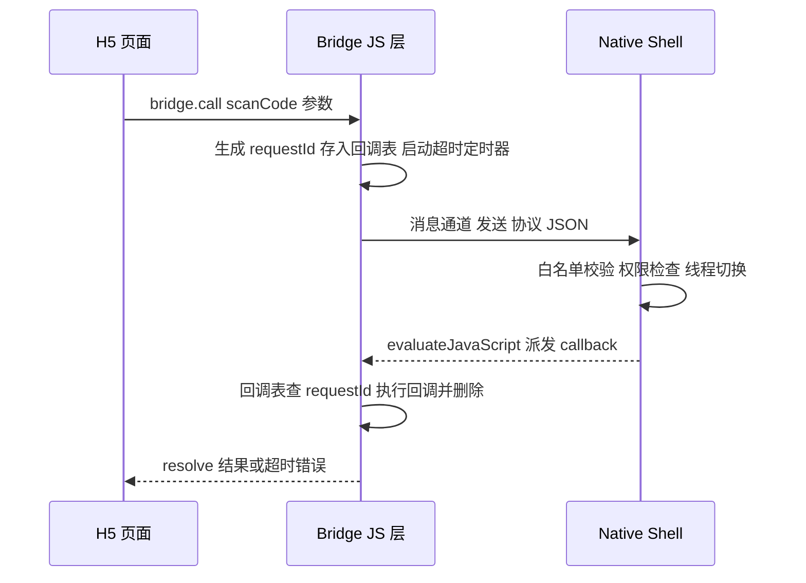

## XP-028：设计一个完整的 JSBridge（协议、回调表、超时、线程安全）？
**答**：
- 协议要素：**唯一 requestId**（关联调用与回调）、方法命名空间、参数、版本号；回调经 `window.__bridge_cb_<id>` 派发，用完即焚。
- 传输通道：iOS 用 `WKScriptMessageHandler`（H5→原生）+ `evaluateJavaScript`（原生→H5）；Android 用 `addJavascriptInterface` 或 `prompt/onJsPrompt` 拦截（兼容老内核）。
- 必备机制：**超时**（定时器清理回调表防泄漏）、**取消**、**重复注册防护**、**序列化大小限制**、**线程切换**（原生统一回主线程再 evaluate）。
- 安全：域名白名单（哪些页面可调敏感 API）、参数校验、高危 API 二次确认。
- 双向对等：原生调 H5 用同一协议（原生作为 caller 走回调表），保持对称。



```javascript
// H5 侧 JSBridge 完整实现
const CALLBACK_PREFIX = '__bridge_cb_';
const pending = new Map();                       // id -> { resolve, reject, timer }

function call(method, params = {}, { timeout = 10000 } = {}) {
  const id = `${Date.now()}_${Math.random().toString(36).slice(2, 8)}`;
  return new Promise((resolve, reject) => {
    pending.set(id, { resolve, reject });
    pending.get(id).timer = setTimeout(() => {   // 超时兜底：防回调丢失导致内存泄漏
      pending.delete(id);
      reject(Object.assign(new Error(`bridge timeout: ${method}`), { code: 'E_TIMEOUT' }));
    }, timeout);
    const payload = JSON.stringify({ id, method, params, v: 2 });
    if (window.webkit) window.webkit.messageHandlers.nativeBridge.postMessage(payload); // iOS
    else if (window.nativeBridge) window.nativeBridge.postMessage(payload);             // Android addJavascriptInterface
    else legacyPrompt(payload);                  // Android 老内核走 onJsPrompt 拦截
  });
}

// 原生回调统一入口：native 完成后 evaluateJavaScript(`__dispatch('${id}', ${json})`)
window.__dispatch = (id, errJson, okJson) => {
  const ctx = pending.get(id);
  if (!ctx) return;                              // 已超时/取消，忽略迟到回调
  clearTimeout(ctx.timer); pending.delete(id);
  errJson ? ctx.reject(errJson) : ctx.resolve(okJson);
};
// 原生侧要点：回调表去重、只在主线程 evaluate、API 域名白名单校验后分发
```
