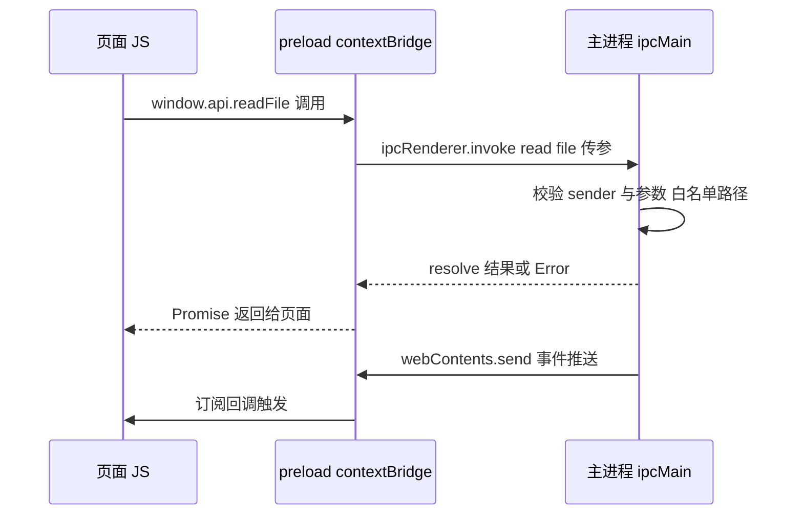

## XP-034：Electron 的 IPC 通信完整链路（ipcMain/ipcRenderer/preload/contextBridge）？
**答**：
- 链路：渲染进程页面代码 → **preload**（唯一桥梁，contextBridge.exposeInMainWorld 暴露白名单 API）→ `ipcRenderer.invoke` → 主进程 `ipcMain.handle` 处理 → Promise 回传。
- 四种模式：`invoke/handle`（请求-响应，推荐）、`send/on`（单向推送 renderer→main）、`webContents.send`（main→renderer 广播）、MessagePort（renderer↔renderer 直连，大数据免经主进程）。
- **contextIsolation**：preload 与页面运行在隔离上下文，只能通过暴露的受控 API 交互，是安全模型的基础（见 XP-035）。
- 易错点：直接给页面暴露 `ipcRenderer` 对象 = 全权授予 IPC 能力（高危）；主进程处理消息必须校验 sender 与参数。



```javascript
// preload.cjs —— 白名单 API 暴露（唯一正确的暴露方式）
const { contextBridge, ipcRenderer } = require('electron');
contextBridge.exposeInMainWorld('api', {
  readFile: (p) => ipcRenderer.invoke('file:read', p),
  onExportProgress: (cb) => {
    const handler = (_e, progress) => cb(progress);
    ipcRenderer.on('export:progress', handler);
    return () => ipcRenderer.removeListener('export:progress', handler); // 返回退订函数
  },
});

// main.ts —— handle 与校验
import { ipcMain } from 'electron';
ipcMain.handle('file:read', (event, p) => {
  if (!event.senderFrame.url.startsWith('https://app.example.com')) throw new Error('forbidden');
  if (!isPathInWhitelist(p)) throw new Error('path not allowed');   // 防任意文件读
  return fs.promises.readFile(p, 'utf-8');
});

// renderer（页面）：
const text = await window.api.readFile('/docs/a.md');
const stop = window.api.onExportProgress((p) => render(p));
```
