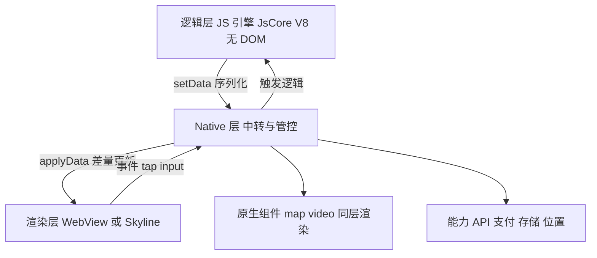

## XP-041：小程序容器的通用架构是什么？各家的双线程模型有何异同？
**答**：
- 通用架构：**逻辑层**（独立 JS 引擎：JsCore/V8，无 DOM/BOM）+ **渲染层**（WebView 或原生渲染）+ **Native 层**（中转通信、原生组件、能力管控、审核体系）。
- 微信：逻辑层单线程 JsCore，渲染层多 WebView（或 Skyline 原生渲染）；setData 经 native 序列化中转。
- 抖音/支付宝基本同构，差异在渲染层实现与通信优化（如支付宝渲染层同构优化、字节部分场景同层渲染策略）。
- 双线程动机：**安全管控**（JS 摸不到 DOM，可静态审查）+ **性能隔离**（逻辑卡不阻塞渲染）+ **跨端一致**。
- Skyline 类方案的趋势：渲染层从 WebView 走向原生渲染，通信链路更短、同层渲染更彻底。



```text
方案            逻辑层引擎        渲染层                    通信优化点
微信小程序      JsCore/V8        WebView / Skyline 原生     setData 差量 同层渲染
支付宝小程序    V8 (部分 NJS)    WebView + 自研渲染优化     初始数据直传 渲染缓存
抖音小程序      JsCore/V8        WebView + 部分原生组件     lyra 类优化 审核流快
统一抽象        独立 JS 线程     与逻辑隔离的 UI 线程        双向消息必经 Native
关键推论        DOM 不可达       WXML 模板驱动              频繁 setData 是第一杀手
```
