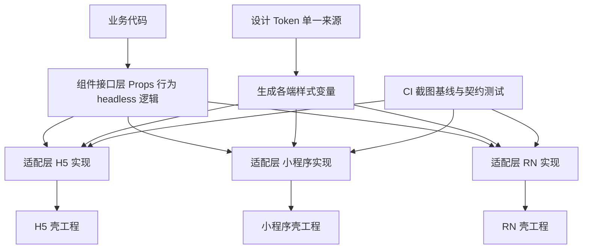

## XP-049：跨端组件库如何设计（平台适配层与样式系统）？
**答**：
- 分层：**接口层**（平台无关 Props/行为与无头逻辑）→ **适配层**（按端实现渲染细节与平台事件）→ **样式层**（设计 token 统一，编译期单位转换）。
- 实现策略按端：小程序/H5 走同一 DSL 模板编译；RN 用独立实现文件（`Button.rn.tsx`）；缺失能力组件（如 canvas 类）提供降级实现。
- 样式系统：设计 token（颜色/间距/字号/圆角）单一来源，生成各端变量（CSS 变量 / RN StyleSheet 主题 / 小程序样式常量）。
- 质量门禁：每组件多端截图基线（XP-072）+ API 单测 + 无障碍属性检查。
- 版本策略：语义化版本 + 变更日志按端标注差异，业务按端锁版本升级。



```typescript
// packages/ui/Button —— 平台适配层结构
// index.ts       —— 统一出口（类型 + 无头逻辑 + 按端分发）
// useButton.ts   —— headless：禁用/加载/点击节流/无障碍 props 生成
// button.h5.tsx  —— H5/小程序共用实现
// button.rn.tsx  —— RN 实现
// token.scss / token.ts —— 来自设计 token 生成的变量

export function useButton(props: ButtonProps) {           // 逻辑只写一遍
  const { loading, disabled, onPress } = props;
  const throttled = useMemo(() => throttle(onPress, 500), [onPress]);
  return {
    handlers: { onClick: disabled || loading ? undefined : throttled },
    a11y: { role: 'button' as const, 'aria-disabled': disabled, 'aria-busy': loading },
  };
}
// button.rn.tsx：
export function ButtonRN(props: ButtonProps) {
  const { handlers, a11y } = useButton(props);
  const s = useTokenStyleSheet((t) => ({                 // token.ts 生成 RN 主题
    root: { backgroundColor: t.color.primary, borderRadius: t.radius.md, height: t.space.x8 },
  }));
  return (
    <Pressable accessibilityRole="button" accessible {...a11y}
      onPress={handlers.onClick} style={[s.root, props.style]}>
      <Text style={{ color: t.color.onPrimary }}>{props.children}</Text>
    </Pressable>
  );
}
// index.ts：export const Button = process.env.TARO_ENV === 'rn' ? ButtonRN : ButtonH5;
```
