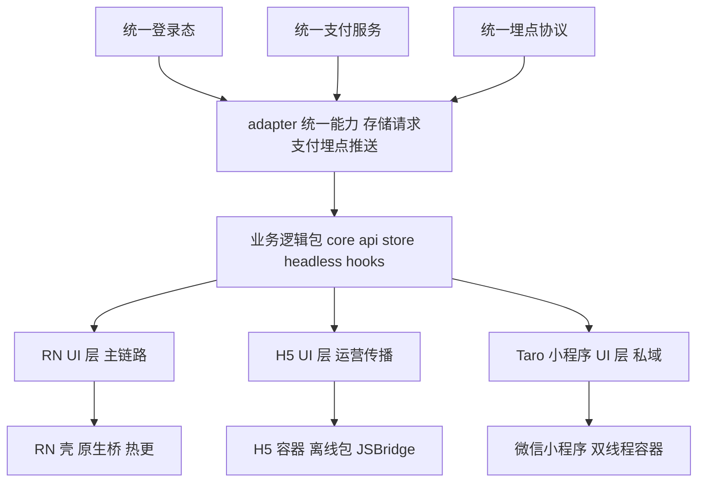

## XP-053：设计一个电商 App 的跨端架构（RN / H5 / 小程序三端）？
**答**：
- 分端定位：**RN** 承载主链路（首页/商品/购物车/订单，性能与体验优先）、**H5** 承载运营与传播页（活动、分享落地，免审核热更）、**小程序** 承载私域流量（微信生态拉新与裂变）。
- 架构落地：monorepo 分层（XP-047），业务逻辑包全端复用，UI 层"RN 自有 + Taro 小程序 + H5 共用"两条 UI 线，adapter 抹平存储/请求/支付/埋点（XP-045）。
- 关键横向系统：登录态（SSO+桥同步）、支付（各端渠道收口到统一支付服务）、埋点（统一协议 XP-058）、热更（RN bundle + 离线包 + 小程序审核节奏，XP-074）。
- 发布协同与兼容矩阵按 XP-052 管理；性能口径统一到跨端看板（XP-069）。



```text
mall-cross/
├── packages/
│   ├── core/            # 商品/订单/购物车领域模型与校验（三端复用）
│   ├── api/             # 统一请求协议（签名 重试 竞态处理）
│   ├── store/           # 购物车/订单状态机（zustand，纯逻辑）
│   ├── hooks/           # useCart usePayBridge useTrack（headless）
│   ├── adapter/         # h5/rn/weapp 三套实现（XP-045）
│   └── tracking/        # 埋点 SDK（XP-058）
├── apps/
│   ├── rn-app/          # RN 壳：首页 商详 购物车 订单（Fabric + FlashList）
│   ├── h5-app/          # H5：活动页 分享落地页 帮助中心
│   └── mini-app/        # Taro 编译到微信小程序：私域玩法
└── infra/
    ├── gateway/         # BFF：按端裁剪接口（小程序弱机型返回精简 schema）
    └── release/         # 版本对齐与灰度（XP-052）
关键决策：主链路 RN 保体验；活动页 H5 保热更速度（大促一天多改）；
小程序端复用 core/store，UI 走 Taro 线——双 UI 线是成本与体验的平衡点。
```
