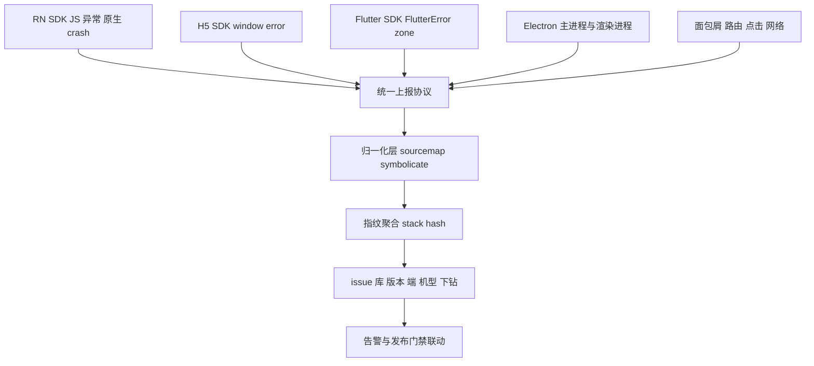

## XP-068：设计一个跨端错误监控体系（堆栈归一化）？
**答**：
- 数据链路：各端 SDK 采集（JS 异常/unhandledrejection、RN ErrorUtils+原生 crash、Dart FlutterError、Electron 主进程 uncaughtException、WebView 白屏联动 XP-031）→ 统一上报协议 → 归一化 → 聚合 → 告警。
- **堆栈归一化**是核心难点：RN 压缩堆栈要 sourcemap 反解；Hermes 字节码栈格式不同；Dart 栈是 Dart 帧；原生栈要 symbolicate——统一到 `frames: [{ file, line, col, fn }]` 模型，版本+平台选择对应 map 反解。
- 聚合维度：**异常指纹**（归一化后 stack hash + message 模板化，去掉变量部分）→ issue 聚合，按版本/端/机型下钻。
- 上下文：面包屑（路由/点击/网络请求）、设备与版本、灰度分桶（对接 XP-067，快速定位"某 flag 引发"）、release 健康度（崩溃率阈值联动发布门禁 XP-052）。
- 降噪：采样控制、重复折叠、已知问题标记，避免告警疲劳。



```typescript
// infra/monitor/normalize.ts —— 堆栈归一化
export interface Frame { file: string; line: number; col: number; fn?: string }
export interface NormalizedError {
  platform: 'rn' | 'h5' | 'flutter' | 'electron';
  appVer: string; osVer: string; device: string;
  message: string; frames: Frame[]; fingerprint: string; breadcrumbs: Breadcrumb[];
}
export async function normalize(raw: RawReport): Promise<NormalizedError> {
  let frames: Frame[] = raw.frames;
  if (raw.platform === 'rn') {
    const map = await sourceMapRepo.get(raw.appVer, raw.bundleHash);       // Hermes 栈反解
    frames = frames.map((f) => map ? applySourceMap(map, f) : f);          // file→ts 源码行列
  } else if (raw.platform === 'flutter') {
    frames = parseDartFrames(raw.rawStack);                                // Dart 帧格式解析
    if (raw.nativeStack) frames.push(...symbolicate(raw.nativeStack));     // 原生栈符号化
  } else if (raw.platform === 'electron') {
    frames = raw.frames.map(cleanElectronFrame);                           // 去 app:// 内部帧
  }
  const fingerprint = hash(normalizeMsg(raw.message) + frames.slice(0, 5).map(fmt).join('\n'));
  return { ...raw, frames, fingerprint };
}
function normalizeMsg(m: string) {   // 模板化：去掉变量，让同类异常聚合
  return m.replace(/\b[0-9a-f-]{8,}\b/g, '<id>').replace(/\d+/g, '<n>');
}
```
