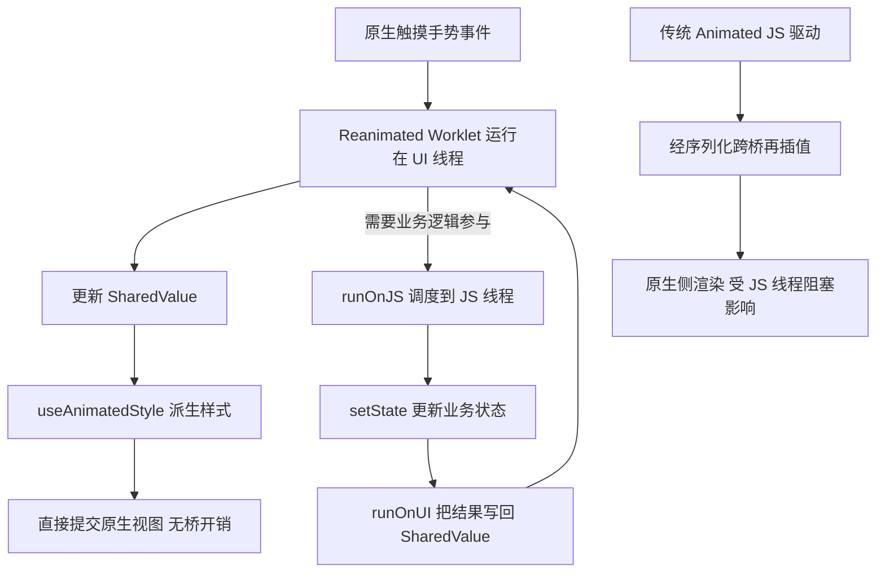

## XP-080：RN 动画系统？Animated 与 Reanimated 的原理与线程模型差异？
**答**：
- RN 旧 `Animated`：动画计算默认跑在 **JS 线程**，JS 忙时掉帧；`useNativeDriver: true` 后参数插值移到原生 UI 线程，但**不支持 layout 属性**（width/height）且手势联动无法闭环。
- **Reanimated 3 核心：worklet**——JS 函数编译后运行在 **UI 线程**，手势识别、SharedValue 更新、样式计算、提交渲染全链路在 UI 线程闭环，JS 线程阻塞（网络回调/大计算）不影响动画帧率。
- 关键概念：`useSharedValue`（UI 线程持有的可变值）、`useAnimatedStyle`（依赖 SV 的派生样式）、`runOnJS`/`runOnUI`（跨线程调度）、`withSpring/withTiming`（UI 线程动画器）、layout animations（进出场）。
- 线程纪律：worklet 内不能碰 JS 侧状态（需 runOnJS）；高频手势（跟手拖拽、BottomSheet）必须 Reanimated；低频属性动画 Animated + native driver 依旧够用。
- 底座差异：新架构下两者都走 JSI，但 Reanimated 自持 UI 线程 runtime，避免序列化，是复杂交互动画的事实标准（与 XP-076 列表、XP-077 启动并列为 RN 性能三大件）。

