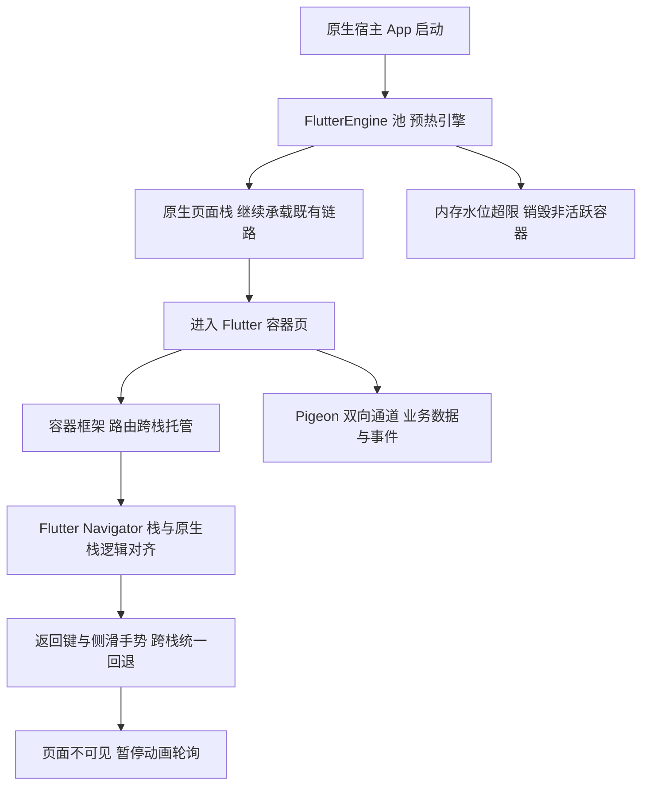

## XP-085：Flutter 混合开发（Add-to-App）怎么做？混合栈如何管理？
**答**：
- 形态：`flutter create --template=module` 产出可嵌入工程，原生宿主持有 `FlutterEngine`；**引擎复用**（单引擎多容器，共享 isolate/内存）vs 多引擎（内存翻倍、通信孤岛）——默认单引擎 + 引擎池预热。
- 混合栈核心矛盾：原生 Navigation 与 Flutter Navigator 是两套栈，直接 push 会"栈分裂"。用 **flutter_boost / thrio 类容器框架**：Flutter 页面在原生侧对应一个容器 Activity/ViewController，路由请求跨栈转发，保持逻辑栈唯一。
- 关键工程点：页面生命周期同步（Flutter 页面不可见时暂停动画与轮询）、返回键/手势回退跨栈统一、`Pigeon` 定义双向通信（避免手写 MethodChannel）、内存水位下销毁非活跃容器。
- 启动优化：引擎预热在 App 启动后期执行（不与首屏抢主线程）、首路由预指定、AOT 产物随主包或动态下发（合规前提下）。
- 适用边界：核心链路仍原生、少量重 Flutter 页面用 Add-to-App；全量 Flutter 化则直接 Flutter 为主壳（与 XP-113 启动链路对比互补）。

