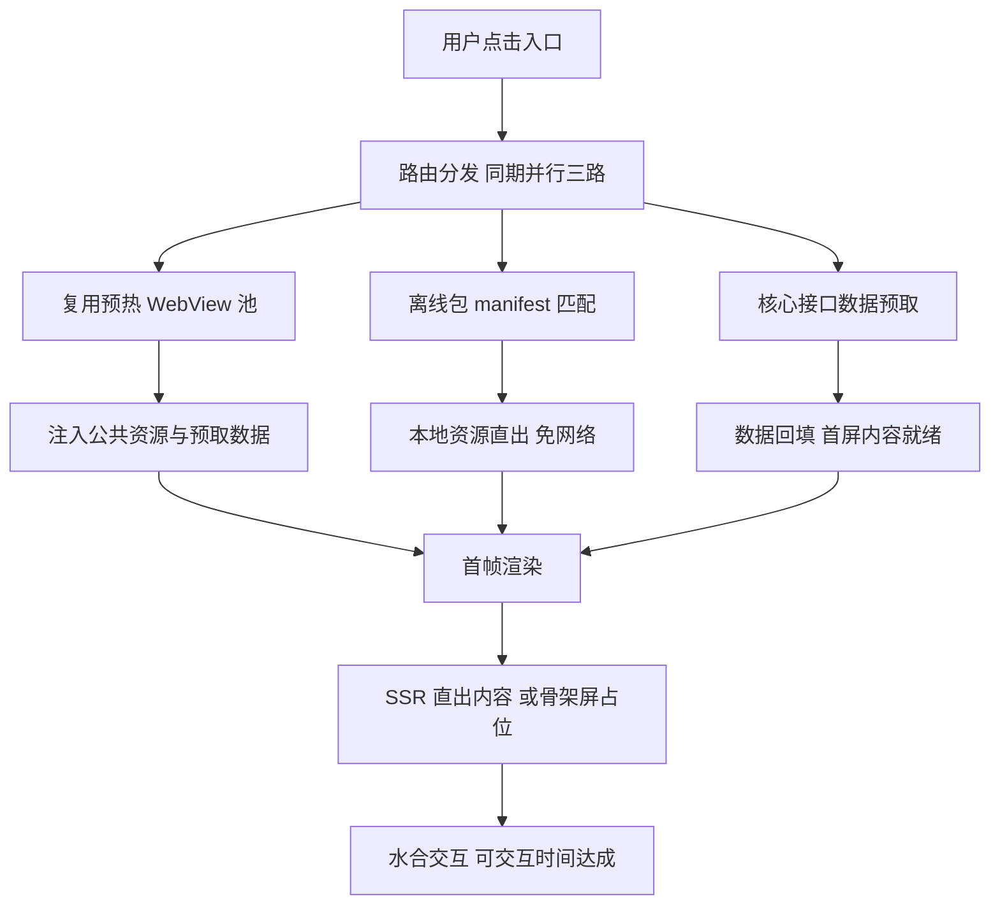

## XP-095：H5 页面秒开方案怎么设计？预渲染、预加载与 SSR 如何组合？
**答**：
- 秒开 = **容器热 + 资源本地 + 数据前置 + 渲染直出** 四件事并行，把点击到首帧串行链路压成并发链路。
- 容器预热：App 启动后台**预创建 WebView 池**（内核初始化是最贵的 200-500ms），点击时复用已就绪容器；页面路由命中后立即注入公共 JS/CSS。
- 数据预取：入口点击瞬间并行发起核心接口请求（接口预取与容器创建并行，回包直接注入页面），高频入口可预请求首屏数据。
- 渲染加速：核心运营页走 **SSR/离线包直出**（HTML 首屏内容随资源包或服务端直达），CSR 页面用骨架屏 + 关键 CSS 内联；图片尺寸预定义防抖动。
- 度量与看护：秒开率（首帧 <1s 占比）、TTI、容器复用率、离线包命中率四指标进 XP-069；回归时用 XP-117 全链路打点定位劣化环节。

