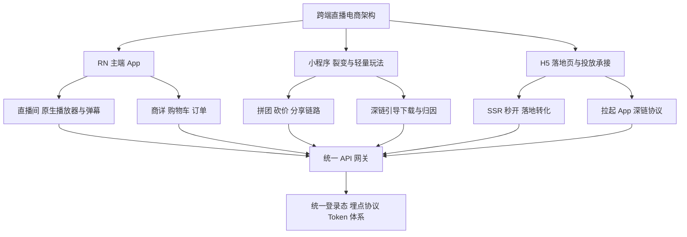

## XP-123：设计一个跨端直播电商 App（RN 主端 + 小程序裂变 + H5 落地页）？
**答**：
- 分工逻辑：**RN 承载核心交易与直播间**（体验+热更能力）、**小程序承接社交裂变**（拼团/砍价分享链路最短）、**H5 承接投放落地**（SEO/秒开/免安装）；三端共用 API 网关、埋点协议、登录态体系。
- 直播间技术要点：播放器用平台原生播放器（低延迟直播协议），弹幕/礼物走 Reanimated（XP-080）与原生通道；商详/购物车页面级组件跨端复用（core 三层组件库 XP-122）。
- 裂变链路：小程序分享卡片 → 打开小程序完成拼团 → 引导下载 App 沉淀（深链携带活动参数归因）；H5 落地页 SSR 秒开（XP-095）+ 拉起 App 深链（XP-066 协议）。
- 一致性保障：Token 统一（视觉）、埋点协议统一（XP-134/111）、行为差异登记表（XP-107）；跨端会话互通（扫码登录/购物车同步）。
- 体系化配套：性能看板（XP-069 口径分端）、灰度发布（XP-137）、大促容量预案（离线包预热、CDN 扩容、降级开关 XP-073）。

