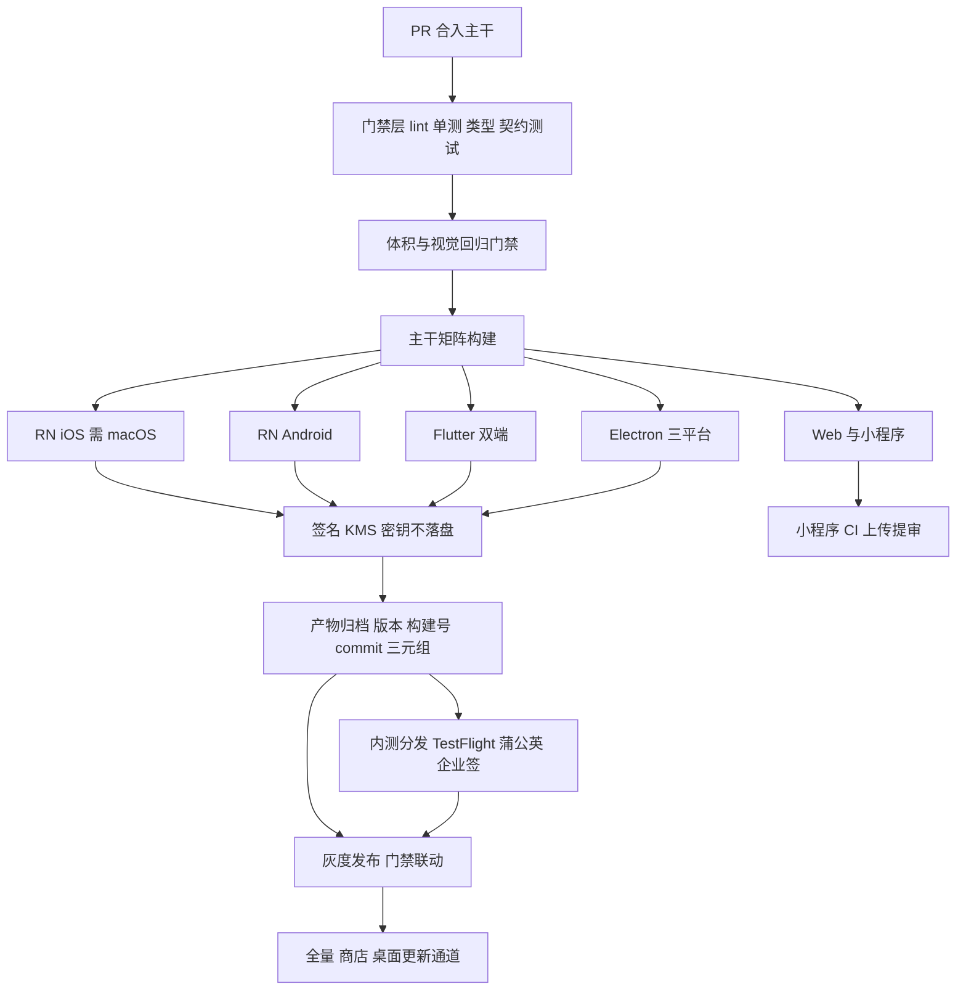

## XP-136：设计一个跨端 CI/CD 体系（矩阵构建 / 签名 / 分发）？
**答**：
- 流水线分层：**PR 门禁（lint/单测/类型/契约测试/体积与视觉回归）→ 主干矩阵构建（多端多平台产物）→ 签名与归档 → 内测分发 → 灰度发布（XP-137）**；每层产物版本化唯一（版本号+构建号+commit sha 三元组可追溯）。
- 矩阵构建：按端拆并行 job（RN iOS 需 macOS、RN Android、Flutter 双端、Web/小程序、Electron 三平台），缓存策略（gradle/cocoapods/pub/monorepo 构建缓存）决定流水线时长。
- 签名安全：证书与密钥进 KMS/CI secret，**构建机不落盘持久密钥**；macOS 公证+Windows 签名自动化；签名产物 hash 归档，热更包签名同链路（XP-083）。
- 分发矩阵：内测（TestFlight/蒲公英/企业签）、商店（App Store/Google Play/各安卓市场）、桌面（自动更新通道 XP-101）、小程序（CI 上传+提审自动化）——统一发布单驱动，禁止绕过流水线手工发版。
- 度量与守护：流水线时长/成功率看板，flaky 用例隔离机制；主干 red（构建失败）15 分钟内必须有人响应（值班制）。

