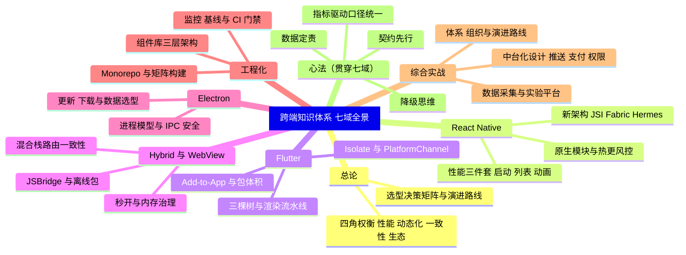

## XP-150：跨端知识体系收束：七域全景图？
**答**：
- 七域划分：**总论（选型与决策）、RN、Flutter、Hybrid 与 WebView、Electron、工程化、综合实战**——本专题 150 题的结构即知识地图，复习按域归位、面试按域调用。
- 各域核心母题：总论=四角权衡（性能/动态化/一致性/生态）；RN=桥的演进（旧架构→JSI）+ 性能三件套（启动/列表/动画）；Flutter=三棵树与自绘+混合开发；Hybrid=桥与容器（离线包/秒开/内存）；Electron=进程模型与安全；工程化=契约先行+矩阵构建+中台化；综合=把前六域组合成系统方案。
- 跨域通用心法：**契约先行、指标驱动（口径统一）、降级思维（能力缺失有预案）、数据定责（不靠感觉）**——四条心法贯穿所有域，是面试收尾时的"升华句"素材。
- 学习路径建议：总论 → 一个原生渲染栈深入（RN 或 Flutter）→ Hybrid/Electron 广度 → 工程化与体系 → 综合实战串联；避免平均用力。
- 面试调用策略：初级岗答"是什么+对比"，中高级答"原理+性能治理+量化口径"，架构岗答"选型论证+体系设计+组织协作"——同一知识点三档深度。

