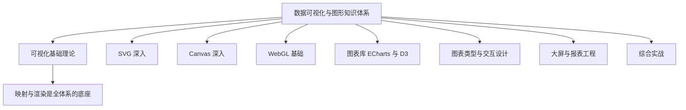

# 前端面试题库：数据可视化与图形

> 定位：大厂可视化团队 / 数据产品线方向面试题库。覆盖 SVG / Canvas / WebGL / ECharts / D3 / 图表类型原理 / 交互设计 / 大屏与报表工程 / 综合实战九大领域，强调"数据 → 映射 → 渲染 → 交互 → 工程"的完整链路。每题均配有可直接落地的核心代码实现。
>
> 本文收录 VIZ-001 ~ VIZ-200：前十章为基础与工程实战，十一至二十章为进阶专题（WebGL 进阶 / WebGPU / 高级图表 / 源码深潜 / 大数据可视化 / 工程化 / BI / 地理空间 / 性能深水区 / 综合大题与体系）。

## 目录

- 一、可视化基础理论（VIZ-001 ~ VIZ-007）
- 二、SVG 深入（VIZ-008 ~ VIZ-014）
- 三、Canvas 深入（VIZ-015 ~ VIZ-021）
- 四、WebGL 基础（VIZ-022 ~ VIZ-029）
- 五、ECharts 工程（VIZ-030 ~ VIZ-037）
- 六、D3 思想（VIZ-038 ~ VIZ-044）
- 七、图表类型原理（VIZ-045 ~ VIZ-052）
- 八、交互设计（VIZ-053 ~ VIZ-059）
- 九、大屏与报表工程（VIZ-060 ~ VIZ-067）
- 十、综合实战（VIZ-068 ~ VIZ-100）
- 十一、WebGL 进阶（VIZ-101 ~ VIZ-107）
- 十二、WebGPU 与新图形 API（VIZ-108 ~ VIZ-111）
- 十三、数据可视化高级图表（VIZ-112 ~ VIZ-118）
- 十四、图表库源码与原理深潜（VIZ-119 ~ VIZ-125）
- 十五、大数据可视化（VIZ-126 ~ VIZ-131）
- 十六、可视化工程化（VIZ-132 ~ VIZ-137）
- 十七、BI 与数据分析场景（VIZ-138 ~ VIZ-143）
- 十八、地理与空间可视化（VIZ-144 ~ VIZ-149）
- 十九、可视化性能深水区（VIZ-150 ~ VIZ-155）
- 二十、综合大题与体系（VIZ-156 ~ VIZ-200）

---

## 一、可视化基础理论（VIZ-001 ~ VIZ-007）

