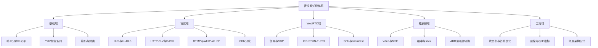

# 前端面试题库：音视频与实时通信

> **专题简介**：本专题聚焦 WebRTC / 直播 / 播放器 / 会议方向的音视频前端能力，是前端岗位中薪资溢价最明显的领域之一。内容覆盖：音视频基础（编码/封装/颜色空间/码率）、媒体标签与 MSE 播放器、流媒体协议（HLS/FLV/DASH/RTMP/WHIP）、WebRTC 核心（信令/SDP/ICE/SFU）、实时互动场景、采集与处理、Web Audio、播放器工程、实时通信工程与综合架构设计。
> **适用人群**：准备音视频/实时通信方向中高级前端面试的工程师，也适合作为团队技术分享与自查清单。
> **难度标注**：多数题目为高频考点，压轴题标注于章内题目标题中；建议先掌握 001-033 的基础与协议部分，再进入场景与工程部分。

## 全景总览

## 目录

- 一、音视频基础（AV-001 ~ AV-008）
- 二、媒体标签与播放器（AV-009 ~ AV-015）
- 三、流媒体协议（AV-016 ~ AV-023）
- 四、WebRTC 核心（AV-024 ~ AV-033）
- 五、实时互动场景（AV-034 ~ AV-040）
- 六、采集与处理（AV-041 ~ AV-047）
- 七、Web Audio（AV-048 ~ AV-053）
- 八、播放器工程（AV-054 ~ AV-060）
- 九、实时通信工程（AV-061 ~ AV-067）
- 十、综合实战（AV-068 ~ AV-100）
- 十一、编解码深入（AV-101 ~ AV-106）
- 十二、WebRTC 源码级与进阶（AV-107 ~ AV-113）
- 十三、SFU 与媒体服务器（AV-114 ~ AV-119）
- 十四、播放器深度工程（AV-120 ~ AV-126）
- 十五、性能与 QoE 深化（AV-127 ~ AV-132）
- 十六、场景工程深化（AV-133 ~ AV-139）
- 十七、安全与合规（AV-140 ~ AV-145）
- 十八、移动端与跨端音视频（AV-146 ~ AV-151）
- 十九、AI 与音视频（AV-152 ~ AV-157）
- 二十、综合大题与体系（AV-158 ~ AV-200）

---

## 一、音视频基础（AV-001 ~ AV-008）

