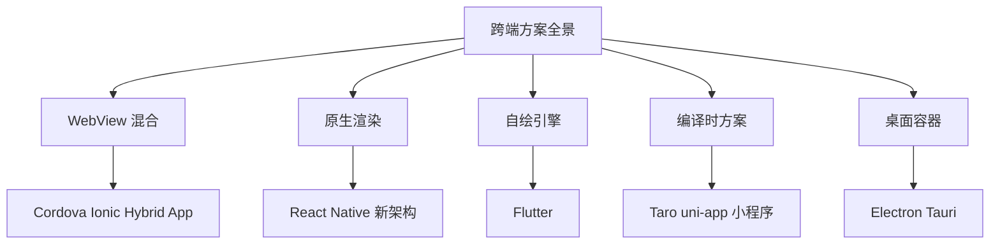

# 前端面试题库：跨端开发深度

## 简介

本专题聚焦**跨端开发深度**，覆盖 React Native（新架构）/ Flutter / Hybrid 与 WebView / Electron / 小程序容器与 uni-app / 跨端工程化 / 综合架构设计七大版块。面向两类岗位画像：**通用前端岗**重点考察原理与选型（JSI、三棵树、JSBridge、IPC 等高频题），**跨端岗**在此基础上深挖实现细节与系统设计（迁移策略、离线包、错误监控、跨端架构设计题）。

- 编号规则：`XP-001 ~ XP-150`（001-075 原理与实战篇，076-150 后续补充）。
- 每题均带一个与题目严格对应的代码/配置/结构块，可直接用于复习自测。
- 技术名词保留英文原文，答案以"要点式"呈现，便于面试口头复述。

## 目录

- 一、跨端总论（001-006）
- 二、React Native 新架构（007-016）
- 三、Flutter 原理（017-025）
- 四、Hybrid 与 WebView（026-032）
- 五、Electron 深度（033-040）
- 六、小程序容器与 uni-app 深度（041-046）
- 七、跨端工程化（047-052）
- 八、综合实战（053-075）
- 九、RN 深度实战（076-083）
- 十、Flutter 深度实战（084-091）
- 十一、Hybrid 深度实战（092-098）
- 十二、Electron 深度实战（099-105）
- 十三、跨端一致性专项（106-112）
- 十四、性能对比与调优（113-118）
- 十五、AI 与跨端（119-121）
- 十六、综合与体系（122-150）

---

## 一、跨端总论（001-006）

