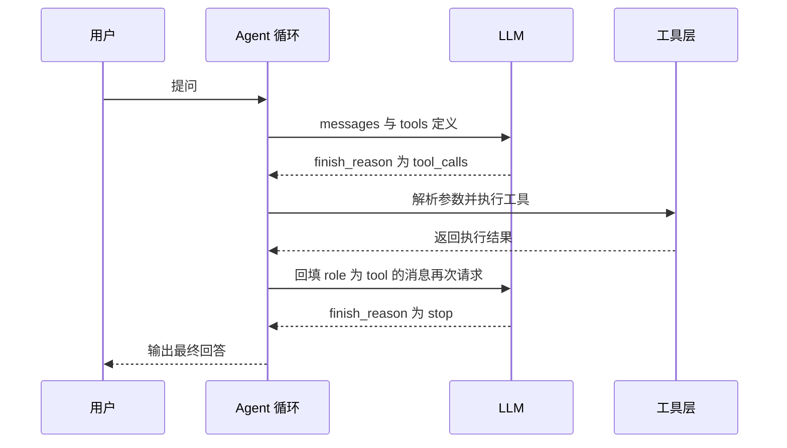

## AGT-015：如何实现 Function Calling 的完整多轮循环？画出时序。
**答**：
- 一轮工具调用后模型可能继续请求调工具（链式调用），必须用 while/for 循环驱动，直到 `finish_reason === 'stop'`。
- 每轮把 assistant 的 tool_calls 和对应的 tool 结果成对追加进 messages。
- 必须有最大轮数保护，防止模型陷入死循环烧钱（见 AGT-019）。
- 循环里每一步都是普通的 chat completion 请求，"Agent"本质就是这个循环。



```typescript
// 完整多轮工具循环：直到模型给出最终回答或触发轮数上限
async function agentLoop(userInput: string, maxRounds = 10): Promise<string> {
  const messages: any[] = [
    { role: 'system', content: '需要数据时调用工具获取，拿到足够信息后再回答用户。' },
    { role: 'user', content: userInput },
  ];

  for (let round = 0; round < maxRounds; round++) {
    const res = await fetchCompletion({ messages, tools });
    const { message, finish_reason } = res.choices[0];
    messages.push(message);

    if (finish_reason !== 'tool_calls') {
      return message.content as string; // 模型认为信息足够，输出最终回答
    }
    for (const call of message.tool_calls) {
      const result = await registry[call.function.name](JSON.parse(call.function.arguments));
      messages.push({ role: 'tool', tool_call_id: call.id, content: JSON.stringify(result) });
    }
  }
  throw new Error('超过最大工具调用轮数，已终止');
}
```
