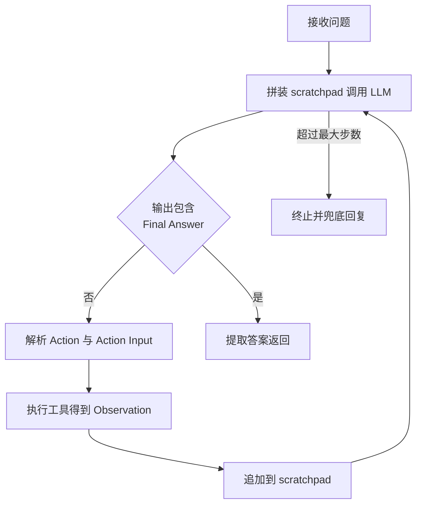

## AGT-018：什么是 ReAct 模式？如何不依赖原生 Function Calling 实现 Thought-Action-Observation 循环？
**答**：
- ReAct = Reasoning + Acting：模型每轮输出 Thought（思考）、Action（选工具）、Action Input（参数），程序执行后把 Observation 回填，循环到 Final Answer。
- 与原生 Function Calling 相比是纯文本协议，任何模型可用，也更容易被人类阅读和调试。
- 核心是一个不断增长的 scratchpad 字符串，每轮把上一步的 Observation 拼回去再请求。
- 工具失败也要作为 Observation 喂回去，让模型自己换路；配合最大步数防失控。



```typescript
// ReAct：用文本协议实现 Thought-Action-Observation 循环
const REACT_SYSTEM = [
  '你是一个使用 ReAct 模式的助手。每一步严格按以下格式输出：',
  'Thought: 你的思考',
  'Action: 工具名，或 Final Answer',
  'Action Input: 工具入参 JSON',
  '当你能回答时，Action 写 Final Answer，Action Input 写最终答案。',
].join('\n');

async function reactAgent(question: string, maxSteps = 8): Promise<string> {
  let scratchpad = `Question: ${question}\n`;

  for (let step = 0; step < maxSteps; step++) {
    const output = await llmComplete(`${REACT_SYSTEM}\n\n${scratchpad}`);
    scratchpad += `${output}\n`;

    const action = output.match(/^Action:\s*(.+)$/m)?.[1]?.trim();
    if (action === 'Final Answer') {
      return output.split('Action Input:')[1]?.trim() ?? '';
    }

    const toolName = action ?? '';
    const input = output.match(/^Action Input:\s*(.+)$/m)?.[1]?.trim() ?? '{}';
    let observation: string;
    try {
      observation = await safeExecute({ function: { name: toolName, arguments: input } });
    } catch (err) {
      observation = `工具执行失败：${String(err)}`; // 失败也作为 Observation 喂回去
    }
    scratchpad += `Observation: ${observation}\n`;
  }
  return '已达最大步数，未能得出结论';
}
```
