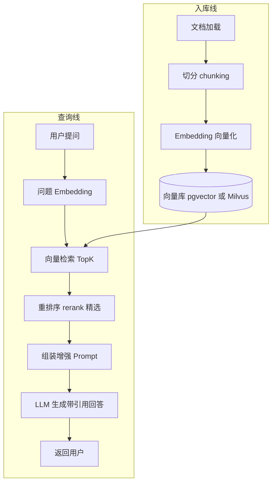

## AGT-025：RAG 全链路是什么？向量库如何选型，检索结果如何组装进 prompt？
**答**：
- 全链路两条线：入库线（切分 → Embedding → 存向量库）与查询线（问题向量化 → TopK 检索 → rerank → 组装 prompt → 生成）。
- 选型：小项目/已有 Postgres 用 pgvector，事务与业务表同库最省事；亿级向量、多租户、高并发选 Milvus；轻量原型可用内存索引（如 hnswlib）。
- 组装时资料要带来源编号，并明确指示"仅根据资料回答、没查到就说明"，这是抑制幻觉的关键。
- 检索分数低到阈值以下时宁可拒答，也不要硬编。



```typescript
// 检索增强 prompt 组装：资料带来源编号，并约束模型只依据资料作答
interface RetrievedChunk {
  id: string;
  source: string;
  text: string;
  score: number;
}

interface VectorStore {
  search(vector: number[], k: number): Promise<RetrievedChunk[]>;
}

export async function answerWithRAG(question: string, store: VectorStore): Promise<string> {
  const queryVector = await embedQuery(question);
  const retrieved = await store.search(queryVector, 5);

  if (retrieved.length === 0 || retrieved[0].score < 0.3) {
    return '知识库中没有找到相关内容，建议补充资料后再提问。'; // 低分拒答
  }

  const context = retrieved
    .map((c, i) => `[${i + 1}] 来源：${c.source}\n${c.text}`)
    .join('\n---\n');

  return llmComplete([
    '仅根据以下资料回答用户问题，资料中没有的信息必须明确说「资料中未提及」。',
    '回答时用 [n] 标注引用了哪条资料。',
    '',
    `资料：\n${context}`,
    '',
    `问题：${question}`,
  ].join('\n'));
}
```
