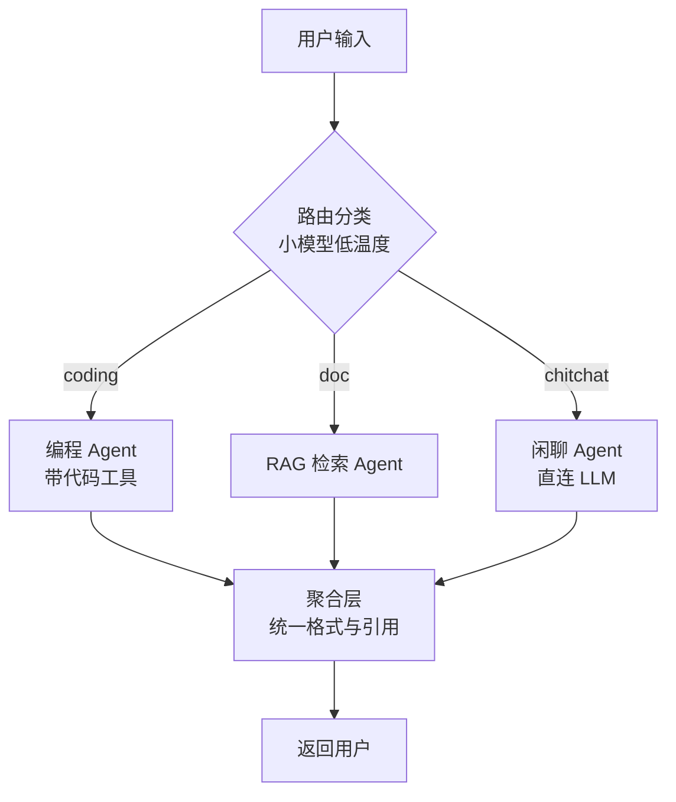

## AGT-037：什么是路由分发（Router）模式？画出一个多 Agent 路由架构。
**答**：
- 一个轻量路由 Agent（通常用小模型 + 低温度）先判断意图，再分发给对应专家 Agent 处理。
- 好处：每个专家的 system prompt 与工具集独立维护互不污染；简单请求走小模型省钱省延迟。
- 路由输出必须是结构化的（枚举 + schema 校验），自由文本路由不可靠。
- 聚合层统一各 Agent 的输出格式（长度、引用、署名），保证前端渲染一致。



```typescript
// 路由分发：小模型分类 + 枚举校验 + 专家处理器表
type Route = 'coding' | 'doc' | 'chitchat';

const RouteSchema = z.object({ route: z.enum(['coding', 'doc', 'chitchat']) });

async function route(userInput: string): Promise<Route> {
  const raw = await llmComplete(
    '把用户输入路由到最合适的处理器，输出 JSON：{"route":"coding|doc|chitchat"}。\n' +
    'coding：写代码、改 bug；doc：查文档、找资料；chitchat：闲聊。',
    { temperature: 0 },
  );
  return RouteSchema.parse(safeJsonParse(raw)).route;
}

const handlers: Record<Route, (input: string) => Promise<string>> = {
  coding: (input) => agentLoop(`请解决以下编程问题：${input}`),
  doc: (input) => answerWithRAG(input, vectorStore),
  chitchat: (input) => llmComplete(input),
};

export async function dispatch(userInput: string): Promise<string> {
  return handlers[await route(userInput)](userInput);
}
```
