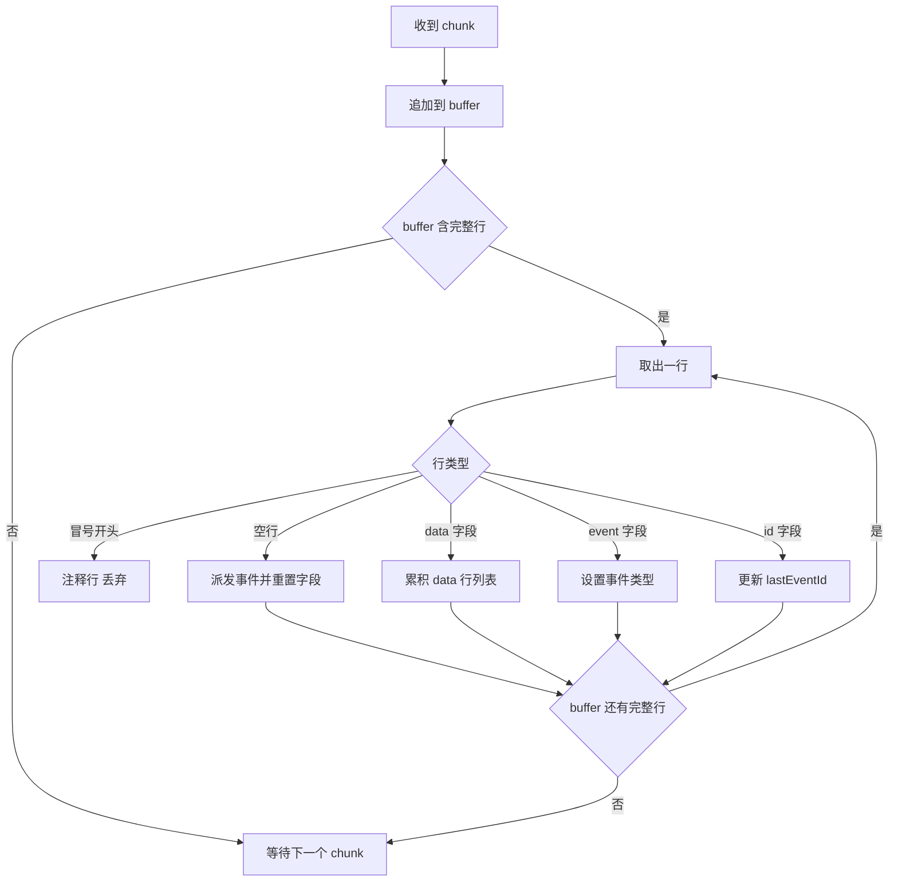

## AGT-041：SSE 流完整解析器如何实现？data:/event:/id: 字段与跨 chunk 边界怎么处理？
**答**：
- SSE 消息由行组成，字段有 `data:` / `event:` / `id:` / `retry:`，空行表示事件边界；同一事件可有多行 `data:`，拼接时以 `\n` 连接。
- 网络 chunk 与事件边界不对齐：必须维护 buffer，只消费到完整行，找不到换行就等下一块。
- 规范细节：注释行（冒号开头）跳过（常用于心跳）；`id:` 更新 lastEventId 供断线续传；`event:` 缺省为 message；冒号后第一个空格要去掉。
- LLM 场景 `data:` 是 JSON 增量或 `[DONE]`，解析器只按事件回调，业务层再 parse。
- `TextDecoder` 用 `{ stream: true }` 防止中文多字节字符被 chunk 截断出乱码；流结束后还要 flush 解码器。



```typescript
// 完整 SSE 解析器：buffer 状态机，跨 chunk 安全
export async function* parseSSE(body: ReadableStream<Uint8Array>): AsyncGenerator<SSEEvent> {
  const decoder = new TextDecoder();
  let buffer = '';
  let event: SSEEvent = { data: '' };
  let dataLines: string[] = [];

  for await (const chunk of body) {
    buffer += decoder.decode(chunk, { stream: true });
    let idx: number;
    while ((idx = buffer.indexOf('\n')) >= 0) {
      let line = buffer.slice(0, idx);
      buffer = buffer.slice(idx + 1);
      if (line.endsWith('\r')) line = line.slice(0, -1); // 兼容 \r\n

      if (line === '') {                                  // 空行 = 事件边界
        if (dataLines.length > 0) yield { ...event, data: dataLines.join('\n') };
        event = { data: '' };
        dataLines = [];
        continue;
      }
      if (line.startsWith(':')) continue;                 // 注释行 / 心跳，跳过

      const colon = line.indexOf(':');
      const field = colon < 0 ? line : line.slice(0, colon);
      let value = colon < 0 ? '' : line.slice(colon + 1);
      if (value.startsWith(' ')) value = value.slice(1);  // 规范：去掉冒号后一个空格

      if (field === 'data') dataLines.push(value);
      else if (field === 'event') event.event = value;
      else if (field === 'id') event.id = value;          // 断线续传依据
      else if (field === 'retry') event.retry = Number(value);
    }
  }
  buffer += decoder.decode();                             // flush 剩余字节
  if (dataLines.length > 0) yield { ...event, data: dataLines.join('\n') };
}

// 用法：消费 OpenAI 兼容流式响应
export async function streamLLM(messages: ChatMessage[], onDelta: (t: string) => void) {
  const res = await upStream({ model: 'gpt-4o-mini', messages, stream: true });
  for await (const ev of parseSSE(res.body!)) {
    if (ev.data === '[DONE]') break;
    const delta = JSON.parse(ev.data)?.choices?.[0]?.delta?.content;
    if (delta) onDelta(delta);
  }
}
```
