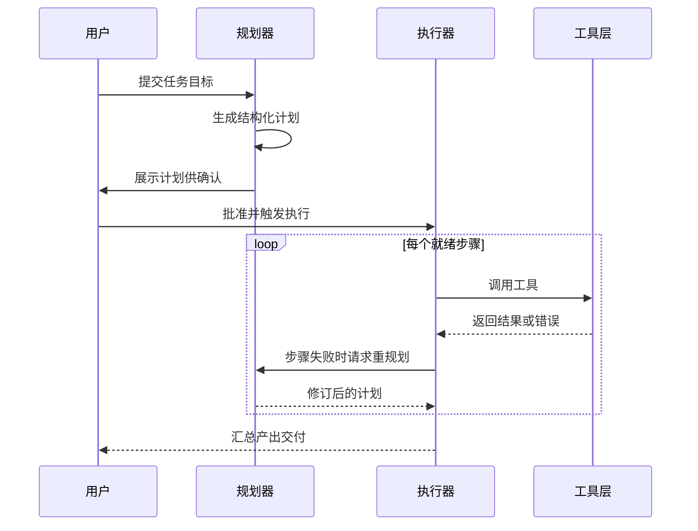

## AGT-063：规划器-执行器分离（Planner/Executor）模式怎么设计？与 ReAct 如何取舍？
**答**：
- ReAct 是「边想边做」，Planner/Executor 是「先规划后执行」：规划器产出结构化步骤清单，执行器按依赖图逐步调用工具，失败时交回规划器重规划（re-plan）。
- 优势：计划可先给人审查（Human-in-the-loop 入口）、无依赖步骤可并行、失败可局部重试；劣势：多一次规划调用的延迟与 token。
- 计划用结构化 JSON（步骤/工具/参数/依赖），与 AGT-058 的依赖图执行器直接衔接。
- 选型：目标明确、步骤多的任务（数据报告、批量操作）用 Planner/Executor；探索型开放任务 ReAct 更灵活。



```typescript
import { z } from 'zod';

// Planner：产出结构化计划；Executor：按依赖执行并支持重规划
const PLAN_SCHEMA = z.object({
  steps: z.array(z.object({
    id: z.string(),
    tool: z.string(),
    args: z.record(z.unknown()),
    dependsOn: z.array(z.string()).default([]),
    goal: z.string(),
  })),
});

async function plan(goal: string, toolSpecText: string) {
  return structuredLLM(
    [
      { role: 'system', content: '你是任务规划器。把目标拆解为可执行步骤，参数可引用前序步骤结果，格式 $stepId.path' },
      { role: 'user', content: `可用工具：\n${toolSpecText}\n\n目标：${goal}` },
    ],
    PLAN_SCHEMA,
  );
}

export async function planAndExecute(goal: string) {
  let planObj = await plan(goal, toolSpecText);
  await approveToUser(planObj);                        // 计划先给人过目再执行
  for (let round = 0; round < 3; round++) {
    const done = await runPlan(planObj.steps, registry); // 复用 AGT-058 依赖图执行器
    const failed = Object.entries(done).filter(([, v]) => String(v).startsWith('工具执行失败'));
    if (!failed.length) return summarize(goal, done);    // 全部成功，汇总产出
    planObj = await rePlan(goal, planObj, failed);       // 失败步骤交回规划器修订
  }
  throw new Error('多次重规划仍未完成，转人工处理');
}
```
