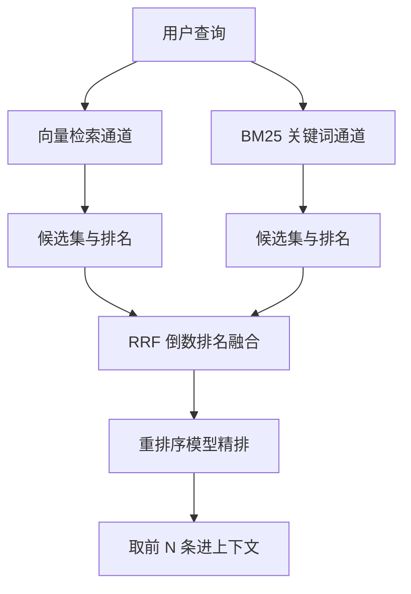

## AGT-071：混合检索（向量 + BM25）怎么做？两路结果如何融合？
**答**：
- 向量检索擅长语义相似但对专有名词/编号/代码弱；BM25 关键词检索相反；生产 RAG 标配是两者并行再融合。
- 融合首选 RRF（倒数排名融合）：每路结果按排名给分 `1/(k+rank)`，同文档跨路相加——不需要对齐两路分数尺度，无需调参。
- 加权分数融合也可以，但 BM25 分与余弦分尺度不同，归一化调参麻烦，RRF 是默认选择。
- 融合后再过重排序器（cross-encoder）精排取 top-N，效果最稳。



```typescript
// RRF 混合检索
const RRF_K = 60; // 平滑常数，经验值 60

function rrfFuse(resultLists: string[][]): { docId: string; score: number }[] {
  const scores = new Map<string, number>();
  for (const list of resultLists) {
    list.forEach((docId, rank) => {
      scores.set(docId, (scores.get(docId) ?? 0) + 1 / (RRF_K + rank + 1)); // rank 从 0 计
    });
  }
  return [...scores.entries()]
    .map(([docId, score]) => ({ docId, score }))
    .sort((a, b) => b.score - a.score);
}

export async function hybridSearch(query: string, topK = 10) {
  const [vectorHits, keywordHits] = await Promise.all([
    vectorStore.search(await embed(query), 20),            // 语义通道
    bm25Index.search(tokenize(query), 20),                 // 关键词通道
  ]);
  const fused = rrfFuse([vectorHits.map((h) => h.id), keywordHits.map((h) => h.id)]);
  const reranked = await reranker.rerank(query, fused.slice(0, 20).map((f) => docs.get(f.docId)!));
  return reranked.slice(0, topK);
}
```
