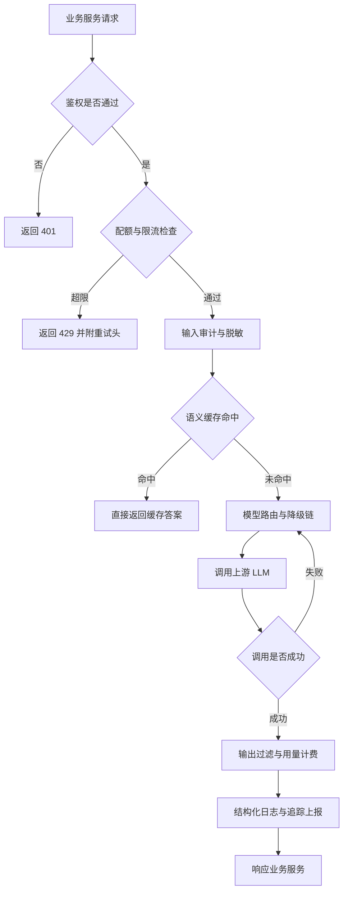

## AGT-097：LLM 代理网关如何完整设计（鉴权 / 限流 / 计费 / 日志统一入口）？
**答**：
- 所有 LLM 流量过统一网关，职责链：鉴权 → 配额与限流 → 输入审计脱敏 → 语义缓存 → 路由与降级 → 上游调用 → 输出过滤 → 用量计费 → 日志追踪。
- 网关持有全部 Key：业务服务不碰供应商凭证，模型切换/密钥轮换对业务零感知。
- 集中才有效：语义缓存、熔断降级、成本优化在网关做一次即全局受益；策略分散在各业务必然失控。
- 网关须无状态水平扩展：限流计数放 Redis，traceId 透传全链路。



```typescript
import { z } from 'zod';

// Express 网关职责链示意
type Handler = (req: any, res: any, next: any) => Promise<void>;
const chain: Handler[] = [
  authenticate,   // JWT 解析，得到 tenant 与 user
  checkQuota,     // Redis：租户每日 token 预算、用户每分钟请求数
  auditInput,     // PII 脱敏（AGT-099）、注入扫描（AGT-050）
  cacheLookup,    // 语义缓存命中直接返回
];

router.post('/v1/chat', ...chain, async (req, res) => {
  const traceId = (req.headers['x-trace-id'] = crypto.randomUUID());
  req.start = Date.now();
  try {
    const model = routeModel(req.body.messages, req.tenant.tier);            // 路由（AGT-078）
    const { text, servedBy } = await completeWithFallback(req.body.messages); // 降级链（AGT-079）
    await cache.put(lastUserText(req.body.messages), text, PROMPT_VERSION);
    const usage = await lastUsage();                                          // usage 统计
    billUsage({ requestId: traceId, userId: req.user.id, model: servedBy, ...usage }); // 计费（AGT-080）
    log.info(JSON.stringify({ traceId, tenant: req.tenant.id, model: servedBy, ms: Date.now() - req.start }));
    res.json({ text, servedBy, traceId });
  } catch (e) {
    res.status(502).json({ error: '上游不可用', traceId });                   // 全链失败兜底
  }
});
// Key 全部在网关环境变量/密钥管理服务，业务服务与前端永不接触
```
